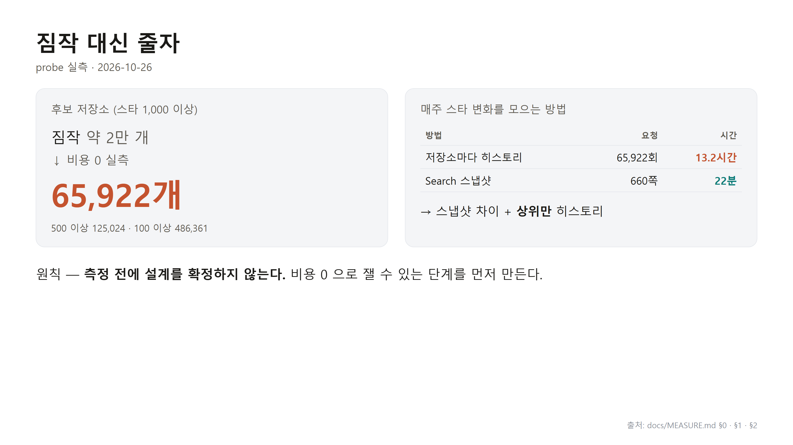
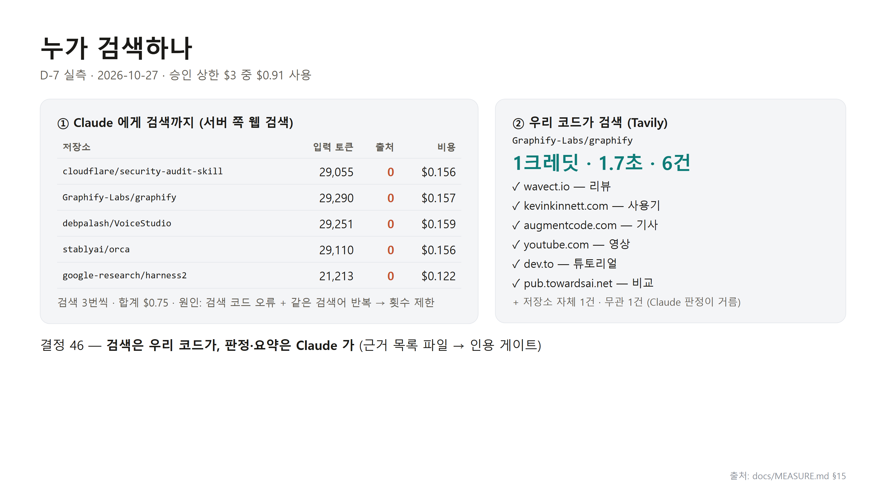

# github-ai-star-trend

English | [한국어](README_KO.md)

> Weekly GitHub star trends → an **AI trend briefing** plus **evidence-backed repository cards**.
> A personal, work-in-progress project built with Claude Code. Project documents (`docs/`) are written in Korean.

## Why

AI tooling changes every week. GitHub stars are a cheap, public signal of where attention goes. This project measures, every week, which repositories gained the most stars, and turns that into:

1. a **weekly AI trend briefing**, and
2. **deep-dive cards** for the repositories behind it, where every claim links to a source.

## Status (2026-10-27)

| Phase | State |
|---|---|
| 0 · Skeleton + measurement | ✅ done |
| 1 · Data core — discover, stars, 52-week backfill, rankings | 🔄 in progress (52-week backfill running) |
| 2 · Classification — is it AI? type, category | 🔄 cost-free groundwork done; paid runs not started |
| 3 · Evidence, cards, briefing | planned |
| 4 · Web UI (Next.js, private Vercel site) · 4b · Notion + blog drafts | design agreed · planned |
| 5 · Weekly GitHub Actions run | planned |

The live progress dashboard is at the top of [`docs/TASK.md`](docs/TASK.md).

## How it works


- **discover** — every repository with ≥ 1,000 stars (about 66,000) plus repositories created in the last 30 days, through GitHub Search split into star ranges so each query stays under the 1,000-result cap. One weekly snapshot takes about an hour.
- **stars** — the difference between this week's and last week's snapshots gives gain candidates; only the top candidates get exact daily counts from the stargazer history API. Calling the history API for every repository would take about 13 hours a week ([`docs/MEASURE.md`](docs/MEASURE.md) §2).
- **rank** — four axes: weekly gain, fresh (created ≤ 30 days ago), growth relative to size, all-time total. "Check this" flags (single-day spike, many new repositories from one owner, dormant-then-explosive growth) are attached with their numbers. **Flags never remove a repository from a ranking.**
- **classify** (Phase 2) — Claude decides is-AI / type / category with schema-constrained output. Code validates the answer, asks once more with the error, and otherwise records "unclassified". Only ranking candidates are classified, walking each axis until it has 15 AI repositories; a repository is re-classified only when its input hash changes.
- **evidence → analyze → brief** (Phase 3) — our code searches (Hacker News and a search API) and records an evidence list; Claude judges and summarizes only within that list, and a citation gate drops claims without a source.
- **blog / notion** (Phase 4b) — weekly drafts go to Notion; a person reviews and publishes. Nothing is posted automatically.

| Measure first: 65,922 candidates; history for each would take 13.2 hours a week | Who should search? Claude's server-side search vs. our code |
|---|---|
|  |  |

<sub>Captures are in Korean; the numbers come from [`docs/MEASURE.md`](docs/MEASURE.md) §1–2 and §15.</sub>

## Engineering rules

- **Measure before designing.** Every assumption that drove the design was measured first, at zero cost ([`docs/MEASURE.md`](docs/MEASURE.md)).
- **Tests first.** The default test run needs no network, no keys, and no money — a fixture blocks sockets. Tests that call real services are marked `live` and excluded by default.
- **Rules are enforced by code, not by memory.** A layer checker (core → clients → budget → stages → cli; stages never import each other; only `clients/transport.py` touches the network; only `clients/claude.py` imports the Anthropic SDK), control tests that prove each checker really catches a violation, and a pre-commit hook: `ruff → mypy (strict) → pytest → size guard`.
- **Weekly star files are immutable** once written; long runs write to a staging folder first.
- **Money has guards.** Every paid step has a dry-run. A budget meter blocks an LLM call *before* it could exceed the cap (weekly budget: $10), and the Anthropic workspace has its own monthly limit.
- **External content is data.** README files and web pages are never treated as instructions.

## Getting started

Requirements: Python 3.12 and a GitHub fine-grained token (public repositories, read-only).

```bash
python -m venv .venv
.venv/Scripts/python -m pip install -r requirements.txt -r requirements-dev.txt   # Windows
# .venv/bin/python -m pip install -r requirements.txt -r requirements-dev.txt     # macOS / Linux
git config core.hooksPath scripts/hooks
```

Environment variables — set them in your environment, **never commit them** (`.env` is gitignored):

| Variable | Used for |
|---|---|
| `GITHUB_TOKEN` | discover · stars · backfill · rank |
| `STARTREND_ANTHROPIC_API_KEY` | classification and cards (later phases). A project-specific name on purpose: other tools may pick up `ANTHROPIC_API_KEY` |
| `STARTREND_TAVILY_API_KEY` | evidence search (Phase 3) |
| `NOTION_TOKEN` | Notion pages (Phase 4b) |
| `STARTREND_DATA_DIR` · `STARTREND_WORK_DIR` | optional — override `data/` and `.work/` |

```bash
python -m startrend contract                # check the GitHub API contract (stops on format changes)
python -m startrend discover                # weekly snapshot: ~1,170 search requests, ~1 hour, free
python -m startrend stars                   # this week's gains (needs last week's snapshot)
python -m startrend backfill --weeks 4      # one-off history backfill (52 weeks ≈ 150,000 requests)
python -m startrend rank --all              # rankings for every week with a star file
python -m startrend classify --all          # dry-run: counts and cost range, no API calls
python -m startrend trends --all            # category trends (+ALL) per week, no API calls
python -m startrend eval --gold data/eval/goldset_classify.jsonl   # dry-run; add --predictions to score
```

```bash
python -m pytest            # default gate: no network, no keys, no cost
python -m pytest -m live    # real API calls (may cost money)
```

## Repository layout

```
startrend/   core/ (weeks, IO, snapshots, taxonomy) · clients/ (GitHub, LLM, Claude, decisions)
             stages/ (discover · stars · backfill · rank · goldset · classify) · budget.py · prompts/
data/        canonical data — weekly star files, rankings, taxonomy, evaluation sets
docs/        SPEC · PLAN · TASK · DESIGN · MEASURE (Korean), diagrams, video notes
scripts/     diagram renderer, size guard, measurement scripts, git hooks
tests/       unit tests with synthetic fixtures
```

`.work/` (gitignored) holds response caches and intermediate files.

## Data notes

- Star counts and weekly gains come from the GitHub REST API and are **computed by this project**. They can differ slightly from what github.com shows (for example because of unstars or timing).
- "Check this" flags are heuristics, **not accusations**.
- This project is not affiliated with GitHub, Anthropic, Tavily, or Notion.

## Making-of

The project was built with Claude Code as a pair programmer: people make the decisions, the code measures, and tests guard the rules. [`docs/video/making-of-t1.md`](docs/video/making-of-t1.md) (Korean) records the first two days.

## License

Not decided yet.
