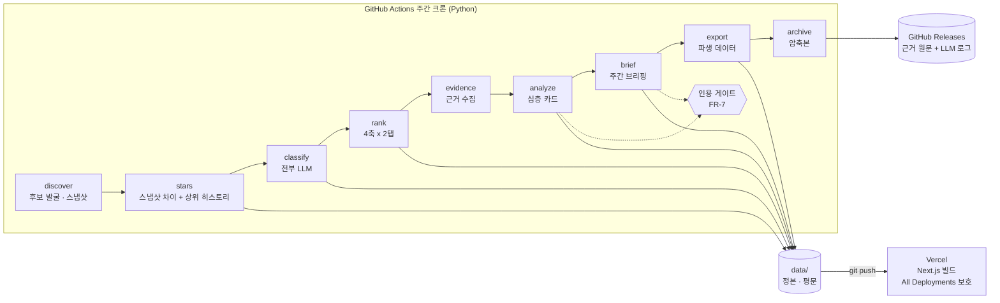
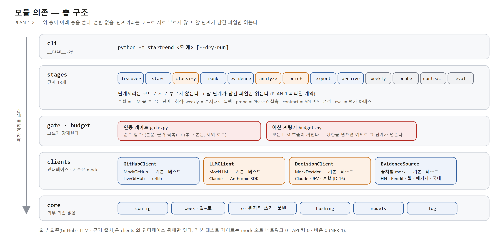
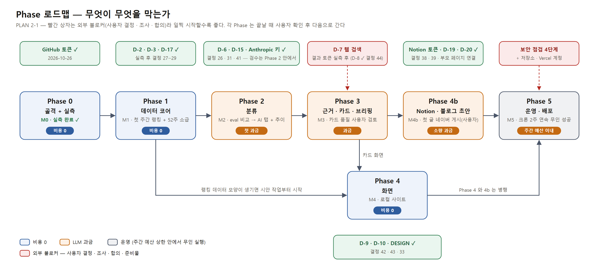
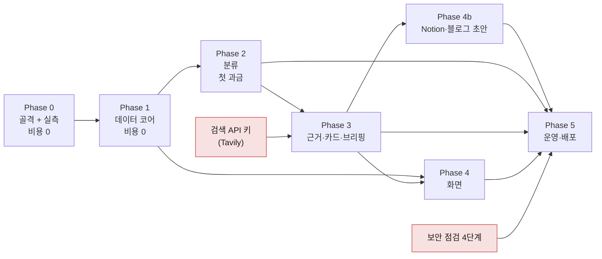
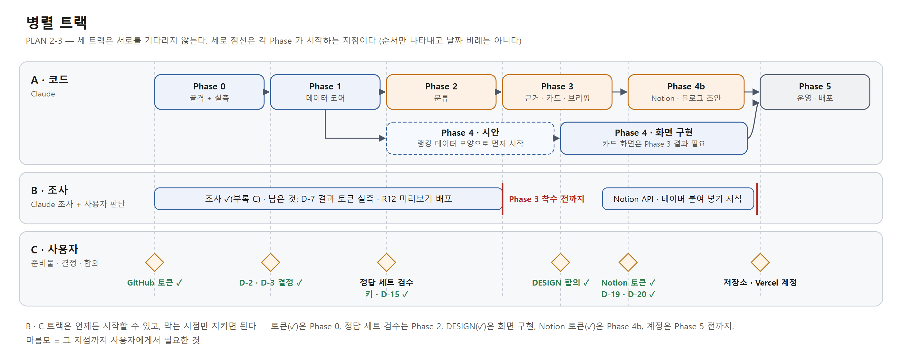

# PLAN.md — github-ai-star-trend

> 최종 갱신: 2026-10-26 · **사용자 확인 완료(2026-10-26), Phase 0 완료 대기(사용자 확인).** SPEC v1.0 기준(실측 결정 27~32, Notion·블로그 결정 34~39, 시험 소급 뒤 결정 40~43, 조사 뒤 결정 44, 블라인드 라벨 뒤 결정 45, 웹 검색 실측 뒤 결정 46 반영).
> 남은 결정: D-16(eval 결과 대기) · D-22(X 근거 출처, Phase 3 뒤) · D-23(공개 저장소에 카드·브리핑을 둘지, Phase 3 커밋 전). 실측 결과는 `docs/MEASURE.md`.
> 그림은 `docs/img/*.png`(원본 `docs/diagrams/*.html`, `scripts/render_diagrams.py` 로 다시 만든다).
> 그림 아래 접힌 "텍스트 버전"(Mermaid·텍스트)이 기준이다.

---

## 1. 아키텍처

### 1-1. 주간 실행 흐름


<details>
<summary>텍스트 버전</summary>



</details>

LLM 을 부르는 단계는 `classify`·`analyze`·`brief` 셋뿐이다. 나머지는 비용 0이다.
분류 범위가 랭킹 후보라(결정 30) 실제 실행 순서는 `stars → rank(전체 탭) → classify → rank(AI 탭 채움)` 이다.
예산을 넘으면 LLM 단계만 멈추고 `rank`·`export` 결과는 그대로 나간다(FR-11.2).

### 1-2. 모듈 의존 (층 — 위가 아래를 쓴다, 순환 없음)



<details>
<summary>텍스트 버전</summary>

```
cli (__main__)          python -m startrend <단계>
  │
stages                  discover · stars · classify · rank · evidence · analyze · brief · blog · export · notion · archive · weekly · probe · contract · eval
  │                     단계끼리는 코드로 서로 부르지 않는다. 앞 단계가 남긴 파일만 읽는다(1-4)
  │
gate · budget           인용 게이트(순수 함수) · 예산 계량기(LLMClient 를 감싼다)
  │
clients                 GitHubClient · LLMClient · DecisionClient · EvidenceSource · NotionClient   ← 인터페이스. 기본 구현은 mock
  │
core                    config · week(일~토) · io(인코딩·원자적 쓰기·불변 가드) · hashing · models · log
```

</details>

### 1-3. 디렉토리

```
github-ai-star-trend/
  startrend/
    core/  clients/  clients/evidence/  stages/  prompts/  gate.py  budget.py  __main__.py
  tests/
    fixtures/            합성 저장소·히스토리 응답·Search 응답·README·근거 문서(악성 README 포함)
  scripts/               size_guard.py · render_diagrams.py(문서 그림 PNG) 등
  web/                   Next.js (Phase 4)
  data/                  정본 (SPEC §4-2)
  .work/                 단계 간 작업 파일. gitignore. Actions 에서는 실행마다 새로 생긴다
  docs/                  diagrams/(그림 원본 HTML) · img/(PNG)
  .github/workflows/
```

### 1-4. 단계 간 파일 계약

단계는 이 표의 파일로만 이어진다. 그래서 합성 픽스처로 각 단계를 따로 개발·테스트할 수 있다.

| 단계 | 읽는 것 | 쓰는 것 | 위치 |
|---|---|---|---|
| discover | 지난 주 랭킹(추적 목록) | 스타 ≥1,000 전체 + 새 저장소 + 추적 저장소의 스냅샷(출처 표시) · 집계 | `.work/snapshots/<주>.csv` · `.work/<주>/discover.json` |
| stars | 이번 주·지난 주 스냅샷, 지난 주 랭킹 | 증가 ≥ 10 행(후보는 정밀 값·요일별, 나머지는 스냅샷 차이) | `data/stars/YYYY/<주>.csv` (불변 — 이미 있으면 건너뜀) |
| backfill (1회) | 막 끝난 주 스냅샷 | 과거 N주 주간 파일 | `data/stars/YYYY/<주>.csv` × N (불변) · `.work/<주>/backfill.json` |
| classify | 랭킹 후보 + meta(판정 입력 해시) | AI 여부·유형·카테고리 | `data/repos/**/meta.json` (해시가 바뀔 때만) |
| rank | 주간 파일 + 그 주 스냅샷(있으면, 누적 축) + 지난 주 랭킹(순위 변동) | 4축 랭킹(전체 탭, AI 탭은 Phase 2) + 급등 패턴 표시 · 랭킹 진입 저장소 메타 | `data/weekly/<주>/rankings.json` (내용이 바뀔 때만) · `data/repos/**/meta.json` |
| evidence | 랭킹(AI 신규·재등장) | 근거 목록 + 원문 | 목록 `.work/<주>/evidence.jsonl`, 원문 `.work/<주>/raw/` |
| analyze | 근거 + 숫자 | 카드 | `data/repos/**/card.md` |
| brief | 랭킹 + 카드 + 카테고리 추이 | 브리핑 | `data/weekly/<주>/briefing.md` |
| blog | 브리핑 + 랭킹 + 주목할 저장소 카드 + 견본(`docs/ref/`) | 주간 블로그 초안 1편 (견본 형식, 인용 게이트 통과) + 사진 배치 문서 + 이미지 PNG | `data/blog/<주>.md` · `<주>-images.md` |
| export | 정본 | 파생 데이터 | `data/site/` |
| notion | 랭킹 + 브리핑 + 카드 + 블로그 초안 + Notion 대응표 | 주간·카드·블로그 초안 페이지 (상태 "초안"인 것만 만들고 고침) | Notion · `data/notion/index.json` |
| archive | `.work/<주>/raw/` + LLM 로그 · 이번 주 스냅샷 | 압축본 | GitHub Release `evidence-<주>` · `snapshot-<주>` |

### 1-5. 설계 판단

- **정체성은 GitHub 저장소 숫자 ID 다.** 이름은 바뀔 수 있다. 폴더 이름은 읽기 좋게 `owner__repo` 로 두고, 이름이 바뀌면 폴더를 옮기고 이전 이름을 meta 에 남긴다. 스타 CSV 의 키도 숫자 ID 다.
- **하위 폴더는 숫자 ID 해시 앞 2자리**(256개)로 나눈다. 한 폴더에 3,000개 제한(GitHub)을 넘지 않고, 이름이 바뀌어도 하위 폴더는 그대로다.
- **예산은 클라이언트 층에서 강제한다.** 모든 LLM 호출은 예산 계량기를 거치고, 상한을 넘으면 예외가 나서 그 단계가 멈춘다. 단계 코드가 예산 검사를 빼먹을 수 없다.
- **인용 게이트는 순수 함수다.** (본문, 근거 목록) → (통과 본문, 제외 로그). LLM 없이 테스트한다.
- **프롬프트는 `startrend/prompts/*.md` 파일로 둔다.** 카드·판정 결과에 프롬프트 해시를 남겨, 어떤 프롬프트로 만든 결과인지 추적한다.
- **판정은 `DecisionClient` 뒤에 둔다.** 구현(Claude · JEV · 혼합)은 정답 세트 비교(FR-14) 결과로 고르고, 언제든 바꿀 수 있다. 결정에 쓰는 수치는 `eval` 리포트에서만 가져온다.
- **규칙은 사람이 아니라 코드가 지킨다(NFR-14).** 네트워크 차단·층 규칙 테스트·커밋 전 훅. 검사기마다 "위반을 실제로 잡는지" 통제군 테스트를 같이 둔다 — 아무것도 못 잡는 검사기가 늘 통과하는 것을 막는다.
- **주간 실행은 API 계약 점검으로 시작한다(FR-11.6).** 형식이 바뀌었으면 정본에 아무것도 쓰기 전에 멈춘다.
- **증가량 후보는 스냅샷 차이로, 정확한 값은 히스토리로.** 후보마다 히스토리를 부르면 주 13시간이다(MEASURE §2). Search 스냅샷(22분)으로 순증가 상위를 고르고, 화면에 나갈 저장소만 히스토리 API 로 달력 주 값과 일별 곡선을 받는다.
- **소급(backfill)은 1회성 로컬 작업이다.** 히스토리 API 는 한 번에 30주를 주므로 저장소당 2쪽이면 52주다. 스타 ≥1,000 6.6만 개 × 2쪽 = 약 26시간 분량 — 응답 캐시로 이어 돌린다(비용 0).
- **Phase 1~4 는 로컬에서 돈다.** 저장소(Releases)가 생기는 Phase 5 전까지 전체 스냅샷은 `.work/snapshots/` 에 둔다. Phase 5 에서 Releases 올리기·받기로 바꾼다.

---

## 2. Phase 로드맵

### 2-1. 의존 그래프 — 무엇이 무엇을 막는가



<details>
<summary>텍스트 버전</summary>



</details>

읽는 법: 빨간 상자는 외부 블로커(사용자 결정·조사·합의)다. 일찍 시작할수록 좋다.
Phase 4 화면은 Phase 1 의 랭킹 데이터 모양만 있으면 시안 작업을 시작할 수 있다. 카드 화면은 Phase 3 결과가 필요하다.
**각 Phase 종료 시 사용자 확인 후 진행한다**(루트 SDD 규칙 7).

### 2-2. Phase 상세

| Phase | 범위 | 선행 | 완료 기준 |
|---|---|---|---|
| **0 골격 + 실측** | `.venv`·도구 설정 · core(week·io·hashing·config) · `GitHubClient`(mock + live) · 합성 픽스처 · **규칙 강제(네트워크 차단·층 규칙·커밋 전 훅·크기 가드, NFR-14)** · **GitHub 계약 점검(FR-11.6)** · `probe`(FR-12.1~12.4, 12.6, 12.7) | GitHub 토큰(사용자) | ruff·mypy·pytest GREEN(외부 의존 0) · **SPEC §5 표가 채워짐** · D-2·D-3 확정 · D-6 금액 제시 🏁**M0** |
| **1 데이터 코어** | discover(Search 분할 열거 ≥1,000 + 새 저장소 30일) · stars(스냅샷 차이 + 상위 후보 히스토리, 증가 ≥10 행만 git) · backfill 52주(로컬 1회) · meta(해시 기반 쓰기·샤딩·이름 변경) · rank 전체 탭 · 급등 패턴 표시 · contract 토요일 반영 경고 · 크기 가드 기준값 | 결정 27~29·32 ✅ | 합성 픽스처 GREEN · 실제 1주 + 52주 소급 실행 · 전체 탭 랭킹 4개가 나옴 🏁**M1** |
| **2 분류** | `LLMClient`(mock + Claude Opus 5.5) · 예산 계량기(주 $10) · Batch API 경로 · `DecisionClient` · taxonomy v1 · classify(**랭킹 후보만 — 축마다 AI 15개까지**, 검증·재질문·미분류·거절 처리·증분·dry-run) · **정답 세트 + `eval`(분류)** · **Claude / JEV / 혼합 비교 → D-16(분류)** · AI 탭 랭킹 · 카테고리 추이 + ALL | 정답 세트 검수(사용자, 결정 41) · JEV 키(비교 시) — Anthropic 키 ✅ | mock GREEN · **정답 세트 비교표를 사용자가 검토하고 분류 구현을 고름** · dry-run 금액 승인 후 첫 전수 분류 · 랭킹 8개 + 추이 🏁**M2** |
| **3 근거·카드·브리핑** | `EvidenceSource`(출처별 mock + live) · 출처 실패 격리 · 인용 게이트 · 급등일 탐지 · analyze(신규·재등장) · brief · 프롬프트 인젝션 방어 · **카드 품질 검사(FR-14.4)** · **게이트 2단계·근거 거르기 후보 비교 → D-16** | D-7 — D-6·D-8 ✅(결정 26·44) | mock GREEN(게이트 우회 불가 테스트 포함) · **카드 5개 시범을 사용자가 검토** → 템플릿 조정 → 1주 전체 🏁**M3** |
| **4 화면** | **선행: `/design` 시안 합의 → `docs/DESIGN.md`** · export · Next.js 골격 · 5년치 합성 데이터 빌드 시간(FR-12.5) · 화면 5종 | npm 패키지 확인(차트 라이브러리 이름 포함) — D-9·D-10·D-13 ✅ 결정 42·43·33 | `npm run lint/test/build` GREEN · 실제 데이터로 로컬 사이트 확인 · raw HTML 꺼짐 확인 🏁**M4** |
| **4b Notion·블로그 초안** | `NotionClient`(mock + live) · `notion-setup`(데이터베이스 3개) · 주간·카드 페이지 발행(초안만 고침, 대응표) · `blog` 초안(Opus 5.5, 견본 형식, 인용 게이트, dry-run) · 사진 배치 문서·이미지 PNG · 블로그 초안 발행 · 네이버 붙여 넣기 서식 확인 | Phase 3(브리핑·카드) — Notion 토큰·부모 페이지 ✅ | mock GREEN("초안 아닌 페이지는 안 고친다" 회귀 테스트 포함) · **실제 1주가 Notion 에서 검토 가능 · 사용자가 첫 글을 네이버에 게시** 🏁**M4b** |
| **5 운영·배포** | archive(Releases·시크릿 검사) · **스냅샷 Releases 올리기·받기** · weekly(**첫 단계 계약 점검**·예산 상한·dry-run·실행 기록, 월 00:00 UTC, **blog·notion 포함**) · 공개 저장소(결정 47 — 무엇을 커밋하는지는 D-23) · Actions 워크플로 · Vercel 연결·보호 | 보안 점검 4단계, 저장소·Vercel 계정(사용자) | 첫 배포 · Vercel 로그인 없이는 열리지 않음 확인 · **크론 2주 연속 무인 성공** 🏁**M5** |

FR-12.5(5년치 합성 데이터 빌드 시간)는 Next.js 골격이 필요해 Phase 4 첫 작업으로 옮겼다. 나머지 실측은 Phase 0 이다.

### 2-3. 병렬 트랙

| 트랙 | 성격 | 담당 |
|---|---|---|
| 🅐 **코드** | Phase 0 → 1 → 2 → 3 → (4 ∥ 4b) → 5, Phase 4 는 1 이후 시안부터 병행 | Claude |
| 🅑 **조사** | D-7·D-8 출처 접근 조건, D-2 대조 출처 상태, R12 Vercel 설정, JEV API 형식·데이터 정책 — 코드와 독립, **언제든 가능** | Claude(조사) + 사용자(판단) |
| 🅒 **사용자 준비물·결정** | GitHub 토큰 · Anthropic 키 · D-6 결정 · 정답 세트 검수(D-15) · DESIGN 합의 · Notion 토큰·부모 페이지 · 저장소·Vercel 계정 · 블로그 게시 | 사용자 |



<details>
<summary>텍스트 버전</summary>

```
🅐  Phase 0 ── Phase 1 ──┬── Phase 2 ── Phase 3 ──┬── Phase 4b (Notion·블로그) ──┬── Phase 5
                         └── Phase 4 (시안 → 화면) ─┴──────────────────────────────┘
🅑  ── 언제든: D-7·D-8 조사, D-2 대조 출처, R12, JEV API ── (Phase 3 착수 전까지, JEV 는 Phase 2 비교 전)
🅒  ── 토큰(Phase 0 전) · 키·D-6·정답 세트 검수(Phase 2 전) · DESIGN(Phase 4 전) · Notion 토큰(✅) · 계정(Phase 5 전)
```

</details>

---

## 3. 마일스톤

| # | 마일스톤 | 의미 | 비용 |
|---|---|---|---|
| M0 | 실측 완료 ✅ 2026-10-26 | 가정이 숫자로 바뀌었다(MEASURE.md). 발굴 방식·축 파라미터·저장·분류 범위·예산 확정 | 0 |
| M1 | 첫 주간 랭킹 + 52주 소급 | 전체 탭 4축이 실제 데이터로 나온다 | 0 |
| M2 | AI 탭 + 카테고리 추이 | 랭킹 8개와 추이 그래프 데이터가 완성된다 | **첫 과금**(전수 분류) |
| M3 | 첫 심층 카드·브리핑 | 사용자가 카드 품질을 검토한다 | 과금 |
| M4 | 로컬 사이트 | 화면에서 한 주가 끝까지 보인다 | 0 |
| M4b | 첫 블로그 글 | 한 주가 Notion 에서 검토되고, 사용자가 첫 글을 네이버에 게시한다 | 초안 1편 (주 $0.2~0.4 추정) |
| M5 | 무인 주간 운영 | 크론 2주 연속 성공, 비공개 배포 | 주간 예산 이내 |

---

## 4. 리스크 (PLAN 관점 — 전체 목록은 SPEC §8)

| # | 리스크 | 대응 |
|---|---|---|
| PR1 | 52주 소급(약 26시간 분량)이 길다 | 응답 캐시로 이어 돌리고 로컬 백그라운드로 1~2일에 나눈다. 먼저 최근 4주만 돌려 파이프라인을 확인한 뒤 전체 |
| PR2 | 소급 후보가 "오늘 기준" 후보라 과거에 떴다가 잊힌 저장소가 빠진다 | 후보군에 "누적 스타 일정 이상" 넓은 풀을 넣는다. 사이트에 생존 편향을 밝힌다(NFR-11) |
| PR3 | 전수 분류 첫 실행 비용이 예상보다 크다 | 표본 분류로 정확도와 1건 비용을 먼저 재고, dry-run 금액 승인 후에만 전수 실행 |
| PR4 | 카드 품질을 Phase 3 끝에서야 알게 된다 | 카드 5개 시범을 Phase 3 안에서 먼저 돌려 사용자 검토 → 템플릿·프롬프트 조정 |
| PR5 | 디자인 합의가 늦어져 Phase 4 가 막힌다 | Phase 1 직후 랭킹 데이터 모양으로 시안을 먼저 시작한다 |
| PR6 | 출처 하나가 막혀 Phase 3 가 멈춘다 (Reddit 은 실제로 막혀 제외 — 결정 44) | 출처는 끼웠다 뺄 수 있게 만들고, 막힌 출처 없이도 완료로 본다(FR-5.7) |
| PR7 | 정답 세트를 만드는 데 사용자 시간이 많이 든다 | Claude 가 초안 라벨을 달고 사용자는 검수만 한다(결정 41, 블라인드 30개로 편향 측정). 애매한 것만 표시해 검수 범위를 줄인다 |

---

## 5. 검증 명령

```powershell
# Python (프로젝트 루트)
.\.venv\Scripts\python.exe -m ruff check .
.\.venv\Scripts\python.exe -m mypy startrend tests scripts
.\.venv\Scripts\python.exe -m pytest              # 기본 게이트 (외부 의존 0, 네트워크 차단됨)
.\.venv\Scripts\python.exe -m pytest -m live      # 실제 외부 호출 (GitHub 무료 / LLM 과금)
.\.venv\Scripts\python.exe scripts\size_guard.py --staged  # 저장 규칙 (커밋 전 훅이 자동 실행)
.\.venv\Scripts\python.exe -m startrend contract  # GitHub API 계약 점검 (GITHUB_TOKEN 필요)

# 커밋 전 훅 켜기 (클론마다 한 번)
git config core.hooksPath scripts/hooks

# Next.js (web/, Phase 4~)
npm run lint; npm test; npm run build
```
