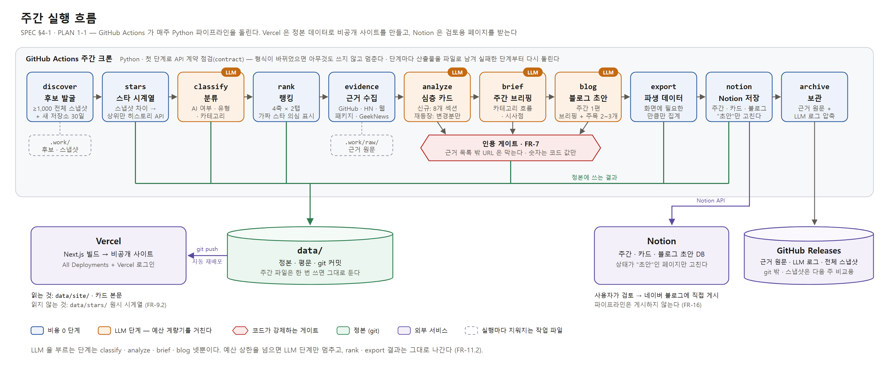
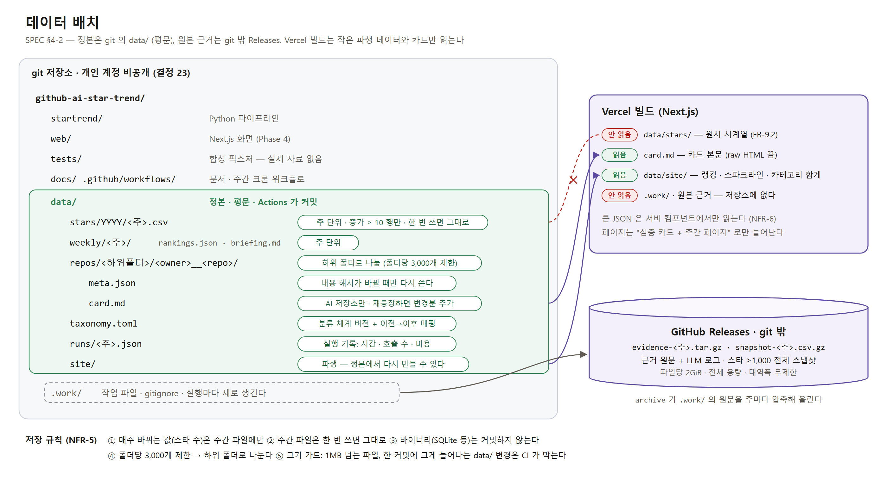

# SPEC.md — github-ai-star-trend

> **v0.9 (2026-10-27) — 초안.** 사용자 토론(아이디어 검토 4회차 + 저장공간 검토 2회 + 미해결 결정 1회차 + 하네스·JEV 검토 + Phase 0 실측 결정 + Notion·블로그 발행 + 블로그 형식 견본 + 시험 소급 뒤 결정 40~43 + 조사 뒤 결정 44 + 블라인드 라벨 뒤 결정 45)을 반영했다.
> §2 는 확정, §9 는 미확정이다. §9 의 남은 결정은 각각 막는 Phase 가 정해져 있다. **PLAN 이 나오기 전에는 구현하지 않는다.**
> 배경·조사 출처: `../ideas/2026-10-26-github-trend-tracer.md`

---

## 1. 목표

GitHub 저장소의 **주간 스타 변화**를 근거로 AI 개발 트렌드를 읽는 개인용 사이트를 만든다.
산출물은 "스타 랭킹 사이트"가 아니라 **주간 AI 트렌드 브리핑 + 그 근거가 되는 저장소 심층 카드**다.
형식은 [트렌드 트레이서](https://utube-trend-tracer.vercel.app/)(유튜브 판)를 빌린다.

### 1-1. 문제 정의 (Why)

GitHub 스타 동향으로 AI 개발 흐름을 보려면 지금은 이렇게 해야 한다.

- GitHub Trending 을 직접 훑는다 — 과거 기록이 없고, 왜 떴는지·실제로 쓰이는지는 따로 찾아야 한다.
- 저장소마다 README·HN·블로그를 손으로 읽는다 — 매주 반복하기에는 양이 많다.
- 개별 저장소를 알아도 **카테고리 단위의 흐름**(무엇이 뜨고 무엇이 식는가)은 보이지 않는다.

이 프로젝트는 스타 시계열을 자동으로 모으고, 처음 떠오른 AI 저장소를 출처가 붙은 카드로 정리하고, 그 위에서 주간 흐름을 종합한다.

### 1-2. 하지 않는 것

- **일간·실시간 랭킹을 만들지 않는다.** 주간이 단위다(결정 3).
- **AI 가 아닌 저장소는 심층 분석하지 않는다.** 전체 탭에는 한 줄 요약만 둔다(결정 5).
- **과거 기간을 심층 분석하지 않는다.** 과거는 랭킹만 소급한다 — 그 뒤 일어난 일을 아는 채로 쓰는 것(후견 편향)을 피한다(결정 8).
- **스타 수를 사용량으로 해석하지 않는다.** 스타는 관심의 신호이고, 실제 사용 근거는 활용사례·다운로드 수로 따로 보여 준다.
- **스타를 누른 계정 정보를 수집하지 않는다.** 2026-06-30 부터 stargazers 목록 API 는 관리자·협업자 전용이다.
- **X(트위터)를 수집하지 않는다.** API 가 유료다.
- **공개 서비스가 아니다.** 개인용으로 시작하고, 공개 전환은 별도 결정이다(결정 4). 밖으로 나가는 것은 사용자가 검토·승인해 **직접 게시하는 네이버 블로그 글**뿐이다(결정 36).
- **네이버 블로그에 자동 게시하지 않는다.** 초안까지만 만든다 — 공식 글쓰기 API 지원이 확인되지 않았고, 비공식 자동 게시는 약관 위험이 있다(결정 36).
- GitHub 외 플랫폼(Hugging Face·Gitee 등)은 범위 밖이다. 확장 후보로만 남긴다.

### 1-3. 사이트 구성 (화면 시안은 `docs/DESIGN.md` 에서 합의 — D-13)

| 화면 | 내용 |
|---|---|
| 이번 주 | 주간 브리핑 요약 + 랭킹표 8개(4축 × 전체/AI 탭) |
| 주간 아카이브 | 지난 주들의 브리핑·랭킹 |
| 저장소 카드 | AI 저장소 심층 카드(§3 FR-6) |
| 카테고리 추이 | 카테고리별 주간 스타 증가 추이 그래프. 카테고리 필터에 **ALL**(모든 AI 카테고리 합계)을 둔다 |
| 소개·방법론 | 지표 정의, "자체 산출값" 고지, 편향(생존 편향·가짜 스타 의심) 설명 |

사이트와 별개로 **Notion**(주간·저장소 카드·블로그 초안 데이터베이스)에 매주 저장하고, 사용자가 검토한 블로그 초안을 **네이버 블로그**에 직접 게시한다(FR-15·16, 결정 34~37).

---

## 2. 확정 결정 (2026-10-26 사용자 토론)

| # | 항목 | 결정 | 근거·영향 |
|---|---|---|---|
| 1 | 대상 범위 | **GitHub 전체 + AI 탭** | 모든 후보에 AI 여부 판정이 필요하다(FR-3) |
| 2 | 랭킹 축 | **기간 증가량 · 누적 · 신규 저장소 · 규모 대비 성장률** (4축) | 4축 × 2탭 = 랭킹표 8개. 파라미터는 실측 후(D-3) |
| 3 | 주기 | **주간** | 처음 들어온 AI 저장소만 심층 분석하고, 다시 들어오면 바뀐 부분만 덧붙인다 |
| 4 | 공개 범위 | **개인용으로 시작** | 품질이 자리 잡으면 공개 여부를 다시 정한다 |
| 5 | 심층 분석 대상 | **AI 탭만** | 비AI 저장소는 한 줄 요약 카드 |
| 6 | 트렌드 종합 | **주간 브리핑 + 카테고리 추이** | |
| 7 | 발굴 방식 | **실측 후 확정** | 후보군 + 히스토리 API 로 시작하고 빠지는 비율을 잰다(§5, D-2) |
| 8 | 과거 기간 | **랭킹만 소급** | 히스토리 API 로 비용 0. 지금 살아 있는 저장소만 남는 편향이 있다 |
| 9 | 활용사례 출처 | **HN · 블로그/튜토리얼(웹 검색) · 패키지 다운로드·의존 수 · 국내 커뮤니티(GeekNews)** (Reddit 은 결정 44 로 제외) | 출처별 접근은 결정 44 |
| 10 | 카테고리 체계 | **고정 분류 + 분기별 재검토** | 15개 안팎. 추이가 끊기지 않게 버전과 매핑을 남긴다(FR-3.4) |
| 11 | 열람 방식 | **Vercel 비공개 배포** | Hobby 에서도 "All Deployments" + Vercel Authentication 으로 운영 도메인까지 비공개. 열람 시 Vercel 로그인 필요 |
| 12 | 실행 방식 | **GitHub Actions 크론** | 주간 예산 상한 필수(NFR-3). 로컬 테스트가 통과한 뒤 마지막에 켠다 |
| 13 | 위치·이름 | 디렉토리 `github-ai-star-trend/`. 파이프라인 패키지 `startrend`, 실행 `python -m startrend` | 패키지·실행 이름은 제안값 |
| 14 | 스택 | **Python 데이터 파이프라인 + Next.js 화면** | 스택 두 개(Python + npm). 화면은 디자인 시안 합의 후 구현 |
| 15 | 심층 카드 템플릿 | **8개 섹션** (FR-6.2) | 디자인 시안 단계에서 다시 다듬는다 |
| 16 | 정본 데이터 위치 | **같은 저장소 `data/` 폴더, 평문** | Actions 커밋 → Vercel 자동 재배포 |
| 17 | 원본 근거·LLM 로그 | **GitHub Releases 주간 압축본** | git 히스토리 밖. 업로드 권한이 커밋과 같은 `contents: write` 라 권한이 늘지 않는다 |
| 18 | 주 정의 (D-1) | **일요일 ~ 토요일.** 주 이름은 시작일(일요일, `YYYY-MM-DD`) | 히스토리 API 의 주(일요일 시작)와 같다. API 는 경계가 UTC 와 맞는다고 보장하지 않으므로 API 가 준 주를 그대로 쓴다. 크론 시각은 Phase 0 실측 후(FR-11.4) |
| 19 | AI 판정 방식 (D-4) | **전부 LLM** | 규칙 사전 필터 없음. 한 번의 호출로 AI 여부·유형 라벨·카테고리를 함께 판정한다(FR-3.1). 판정 입력이 바뀐 저장소만 다시 판정하므로 **첫 실행이 가장 크다** — 비용은 D-6 에서 따로 제시 |
| 20 | 카테고리 초기 목록 (D-5) | **제안 15개 + ALL** | ALL 은 저장소에 붙이는 카테고리가 아니라 모든 AI 카테고리를 합친 보기(필터·추이 합계 선)다 |
| 21 | Python 버전·패키지 (D-11) | **Python 3.12, 런타임 패키지는 Anthropic SDK 1개 + 표준 라이브러리.** 개발용 pytest·ruff·mypy | |
| 22 | 소급 기간 (D-12) | **52주** | 랭킹만 소급(결정 8) |
| 23 | 저장소 구성 (D-14) | **개인 GitHub 계정 비공개 저장소** | Vercel 루트 디렉토리에서 `data/` 를 읽는 방식은 배포 Phase 에서 확인(R12) |
| 24 | JEV (2026-10-26) | **후보로 넣고 실측 비교** | 판정형 모델 JEV(부록 B)를 분류·인용 게이트 2단계·근거 거르기의 후보로 둔다. 평가 하네스(FR-14)로 Claude 단독 / JEV 단독 / JEV→확신 낮은 것만 Claude 를 비교한 뒤 채택 범위를 정한다(D-16). **그때까지 결정 19(전부 LLM)는 유지한다** |
| 26 | LLM 모델 (D-6 일부, 2026-10-26) | **Claude Opus 5.5 (`claude-opus-5-5`)** — 모든 Claude 호출 | 워크스페이스 기본값(`claude-opus-5`)보다 새롭고 단가가 낮다(100만 토큰당 입력 $4 / 출력 $20, 캐시 읽기 $0.20, Batch 50% 할인 — 2026-09-25 공식 표). 사고(thinking)를 끌 수 없어 effort 로만 조절한다(FR-3.10). 예산 상한 금액은 남은 D-6 |
| 27 | 발굴 방식 (D-2) | **Search 스냅샷 + 새 저장소 검색 + 상위 후보만 히스토리 API** | 주 1회 스타 ≥1,000 저장소 전체(6.6만 개)를 Search 로 열거해 스타 수를 스냅샷하고, 지난 주 스냅샷과의 차이로 증가량 후보를 고른다. 30일 이내 새 저장소는 별도 검색. 화면에 나갈 상위 후보만 히스토리 API 로 정확한 주간 값·일별 곡선을 받는다. Trending 은 대조용으로만. GH Archive·OSS Insight 는 쓰지 않는다(Trending 대조 누락 0) — MEASURE §2·§4 |
| 28 | 축 파라미터 (D-3) | **후보군·성장률 축 최소 스타 1,000 · 신규 축 30일 · 노출 5개(펼치면 15개) · 의심 저장소는 표시만** | 의심 표시는 근거 수치(최대일 비중·포크/이슈 비율·같은 계정 동시 생성 수)와 함께. 출시 급등 오탐 사례 때문에 자동 제외하지 않는다 — MEASURE §5. 노출·30일·표시만은 제안에 사용자 이의 없음 |
| 29 | 스냅샷 저장 (D-17) | **주간 증가 ≥ 10 인 행만 git, 전체 스냅샷은 압축해 Releases** | git 주간 파일은 약 0.3~0.5MB(추정)로 1MB 가드 안. 전체 스냅샷(약 2.1MB, 압축 시 더 작음)은 다음 주 비교용으로 Releases 에 둔다 |
| 30 | 분류 범위 (D-18) | **랭킹 후보만** — 축마다 AI 저장소 15개가 찰 때까지 위에서부터 판정 | 판정 방식은 결정 19(전부 LLM) 그대로. 카테고리 추이는 판정된 저장소 기준이라 작은 저장소의 긴 꼬리는 빠진다 — 소개·방법론에 밝힌다(NFR-11) |
| 31 | 주간 예산 상한 (D-6) | **주 $10** (무인 실행의 LLM 비용) | 넘으면 LLM 단계만 멈춘다(FR-11.2). 첫 실행(소급 분류)은 dry-run 금액을 따로 승인받는다. 예상 주 $2~7 — MEASURE §9 |
| 32 | 실행 시각 · 주의 시간대 | **월요일 00:00 UTC (09:00 KST)** · 주는 **UTC** 일~토 | API 주 경계가 UTC 일요일 0시이고 하루 늦게 반영된다(MEASURE §6). 결정 18 을 보완한다. 제안에 사용자 이의 없음 |
| 34 | Notion 저장 (2026-10-26) | **데이터베이스 3개 — 주간 · 저장소 카드 · 블로그 초안.** 매주 실행이 끝나면 자동으로 저장 | 검토 상태(초안 → 검토 중 → 승인 → 게시됨). 파이프라인은 "초안" 상태 페이지만 만들고 고친다 — 사용자가 검토하며 고친 내용을 덮어쓰지 않는다(NFR-16) |
| 35 | 사이트와 Notion | **둘 다 유지** — 사이트는 열람(차트·랭킹), Notion 은 검토·발행 준비 | Phase 4(사이트)와 Phase 4b(Notion·블로그)를 병행 |
| 36 | 네이버 블로그 | **초안 자동 → 검토 → 사용자가 직접 게시** | 자동 게시 없음. 공식 글쓰기 API 지원이 확인되지 않았다(2026-10-26 조사) |
| 37 | 블로그 글 단위 | **주간 1편** — 브리핑 바탕, 랭킹 요약 + 주목할 저장소 2~3개 | 형식은 결정 39 |
| 38 | Notion 데이터베이스 만들기 (D-19) | **`notion-setup` 이 사용자가 지정한 부모 페이지 아래 3개를 만든다** | 속성 이름·형식이 코드와 정확히 맞고, 필요하면 다시 만들 수 있다 |
| 39 | 블로그 형식 (D-20) | **사용자 견본을 따른다** — 본문 `docs/ref/blog-sample.md` · 사진 배치 `docs/ref/blog-sample-images.md` (사용자의 기존 네이버 연재 글) | 시리즈 이름 "깃허브 AI 트렌드 주간 동향" · 합쇼체 · 평문 소제목 · 고정 틀 · 사진 배치 문서 따로 (FR-16.5~16.8) |
| 40 | 급등 패턴 보완 — 휴면 후 폭증 | **표시 추가: 생성 60일 이상 · 4주 전 스타 5,000 미만 · 4주 동안 10배 이상 → "잠잠하다 4주 만에 N배"** | 시험 소급 4주에서 걸린 3개가 모두 수상했다(MEASURE §13). "지난 주 대비 10배 급가속"은 정상 화제 저장소(php-src·Apollo-11 등)가 걸려 넣지 않았다. 결정 28 처럼 표시만 한다. 기준값은 52주 소급 뒤 다시 잰다 |
| 41 | 정답 세트 작성 (D-15) | **Claude 초안 → 사용자 검수, 200개 중 30개는 초안을 가린 블라인드** | 정답 세트가 Claude 대 JEV 비교의 기준이라 초안이 Claude 쪽으로 기울 수 있다 — 블라인드 30개와 검수 결과의 차이로 그 편향을 잰다. 초안 비용 약 $1~3(Batch) |
| 42 | Next.js 렌더 (D-9) | **Vercel 기본 빌드** | 서버 기능(ISR·라우트 핸들러)을 나중에 쓸 수 있다. 조건: 데이터는 빌드 때 `data/site/` 에서 읽고, 라우트 핸들러·미들웨어·서버 액션을 더하면 그때마다 보안 점검 대상(NFR-8). 비공개는 Vercel Authentication |
| 43 | 화면 라이브러리 (D-10) | **차트 라이브러리 + react-markdown(+ remark-gfm)** | 차트 라이브러리 이름은 Phase 4 착수 때 패키지 추가 확인과 함께 정한다(후보 Recharts). 마크다운은 raw HTML 을 끈 채로만 — `rehype-raw` 금지, 테스트로 강제(FR-9) |
| 44 | 근거 출처 접근 (D-8) | **HN(Algolia) · GeekNews(`/past` 날짜별 목록 HTML, 가볍게) · PyPI(pypistats)·npm 다운로드 · "패키지 의존 수"(ecosyste.ms, deps.dev 보조). Reddit 은 제외** | Reddit 은 2025-10부터 API 사전 승인 필수·비인증 차단(부록 C-2). 승인 신청은 나중에 따로 정한다. GitHub "Used by" 는 공식 API 가 없어 다른 이름의 수치로 보여 준다 — 출처(CC-BY-SA·CC-BY) 표기 |
| 45 | AI 저장소의 경계 (D-21) | **넓게** — AI 모델·에이전트를 만들거나·돌리거나·평가하거나·쓰는 저장소, 그리고 **AI 기능을 내세우거나 에이전트 연결(MCP 등)을 제공하는 앱도 AI**. 에이전트가 다룰 수 있을 뿐인 일반 앱, AI 강좌가 일부 있는 범용 교육자료는 비AI | 블라인드 30개 라벨이 보여 준 사용자 기준(AppFlowy·SRS·MCP 를 주는 디자인 앱 = AI, 에이전트가 파일을 고칠 수 있을 뿐인 이미지 편집기·freeCodeCamp = 비AI). classify 프롬프트와 정답 세트 검수의 기준 |
| 33 | 화면 시안 (D-13) | **핵심 3화면 합의** — 이번 주(브리핑 위 크게 + 4축 랭킹 카드 목록, 탭은 AI → 전체·기본 AI) · 저장소 카드(8개 섹션 + 옆 목차) · 카테고리 추이(선 그래프 + 표, ALL 포함) · 반응형 | `docs/DESIGN.md` §6. 아카이브·소개 시안은 Phase 4 안에서 따로 합의 |
| 25 | 하네스 (2026-10-26) | **평가 하네스 · 규칙의 코드 강제 · API 계약 테스트** 추가 | FR-14 · NFR-14 · FR-11.6. 세션 하네스(doctor·대시보드 자동 계산·작업 단위 커밋)는 채택하지 않았다 |

---

## 3. 기능 요구사항

파이프라인 단계는 `python -m startrend <단계>` 로 하나씩 돌릴 수 있고, `weekly` 가 순서대로 묶는다(FR-11).
LLM 을 쓰는 단계는 `classify`(보조)·`analyze`·`brief` 셋뿐이다.

### FR-1 후보 발굴 (`discover`, 비용 0)

| ID | 요구사항 |
|---|---|
| FR-1.1 | 이번 주 후보를 만든다(결정 27): ① 스타 ≥1,000 저장소 전체를 Search 로 열거 ② 30일 이내 생성·스타 ≥10 새 저장소 검색 ③ 지난 주까지 랭킹에 들었던 저장소(기준 아래로 내려가도 추적) |
| FR-1.2 | Search API 는 쿼리당 결과 1,000건이 상한이다. 스타 구간·생성일 구간으로 쿼리를 쪼개 상한에 걸리지 않게 한다 |
| FR-1.3 | 출처별로 몇 개를 찾았는지 기록한다 |
| FR-1.4 | 열거 결과의 스타 수를 **전체 스냅샷**으로 남긴다. 지난 주 스냅샷과의 차이가 증가량 후보 선정의 기준이다(순증가 — 별을 취소한 수가 빠진다) |

### FR-2 스타 시계열 (`stars`, `backfill`, 비용 0)

| ID | 요구사항 |
|---|---|
| FR-2.1 | **상위 후보만** `GET /repos/{owner}/{repo}/stargazers/history` 로 정확한 주간 값과 요일별 수를 받는다 — 스냅샷 차이 상위, 새 저장소 상위, 지난 주 랭킹 저장소. 후보마다 부르면 주 13시간이라 불가(MEASURE §2) |
| FR-2.2 | git 의 주 단위 파일(`data/stars/YYYY/<주 시작일>.csv`)에는 **주간 증가 ≥ 10 인 행만** 쓴다. 전체 스냅샷은 압축해 Releases 에 둔다(결정 29). **한 번 쓴 주 파일은 다시 쓰지 않는다**(NFR-5) |
| FR-2.3 | 주는 일요일 ~ 토요일이고 API 가 주는 주를 그대로 쓴다(결정 18). 주 이름은 시작일(일요일) |
| FR-2.4 | `backfill --weeks 52` — 과거 52주 랭킹을 소급한다(결정 22). 심층 분석은 하지 않는다(결정 8). 스타 ≥1,000 저장소 × 히스토리 2쪽 = 약 13.2만 회·26시간 분량이라 **로컬에서 이어 돌리기로 1회** 실행한다(비용 0). 성장률 축은 과거 스냅샷이 없어 히스토리로 시작 시점 스타를 역산한다 |
| FR-2.5 | 이미 받은 주는 다시 받지 않는다. 중간에 실패하면 받은 저장소부터 이어서 받는다 |
| FR-2.6 | 정밀 값의 주 끝 스타는 두 추정 중 **큰 값**이다. ① 역산: 스냅샷 스타 − target 이후의 주들(진행 중인 주 포함) ② 히스토리 누적 합: target 주까지 더한 값. 둘 다 실제보다 작게 잡힌다 — ①은 스냅샷을 찍은 뒤 히스토리를 받기까지 늘어난 만큼, ②는 히스토리가 생성 시점까지 닿지 않는 만큼. ②에는 그 주 증가가 들어 있어 **주 시작 스타가 음수가 되지 않는다**(2026-10-26 시험 소급에서 ①만 쓸 때 주마다 44~61행이 음수 — MEASURE §13). 순위·증가량에는 영향이 없다 |

### FR-3 분류 (`classify`)

| ID | 요구사항 |
|---|---|
| FR-3.1 | **전부 LLM 이 판정한다**(결정 19). 입력은 이름·설명·토픽·언어·README 앞부분이다. 한 번의 호출이 `{is_ai, type, category, secondary}` 를 함께 돌려준다. `--dry-run` 이 먼저다 |
| FR-3.2 | **유형 라벨** — 도구/라이브러리 · 큐레이션 목록 · 교육자료 · 모델/데이터 · 기타. 북마크형 스타(목록·교육자료)를 도구와 구분해 보여 주기 위함이다 |
| FR-3.3 | **카테고리** — AI 저장소마다 고정 분류(`data/taxonomy.toml`)에서 주 카테고리 1개(+선택적 보조 1개)를 붙인다. 초기 목록은 부록 A(결정 20) |
| FR-3.4 | 분류 체계는 버전을 매긴다. 분기 재검토로 카테고리를 나누거나 합칠 때 이전→이후 매핑을 남겨 추이 그래프가 이어지게 한다 |
| FR-3.5 | **판정 범위는 랭킹 후보만이다(결정 30).** 축마다 순위 위에서부터 판정해 AI 저장소 15개가 찰 때까지 내려간다. 판정 입력의 콘텐츠 해시가 바뀐 저장소만 다시 판정한다. 첫 실행(52주 소급 랭킹의 후보)이 가장 크다 |
| FR-3.6 | **판정 결과 검증은 코드가 한다.** 응답이 정해진 형식이 아니거나 카테고리가 분류 체계에 없으면 받아들이지 않고 한 번 다시 묻는다. 그래도 안 되면 "미분류"로 두고 로그에 남긴다 |
| FR-3.7 | 판정 호출은 Batch API 로 묶는 것을 기본으로 검토한다(D-6). 주간 실행은 실시간일 필요가 없다 |
| FR-3.8 | 판정은 `DecisionClient` 인터페이스 뒤에 둔다. 구현 후보는 Claude · JEV · 혼합(JEV 판정 후 확신이 기준 미만이면 Claude)이고, FR-14 비교 결과로 고른다(D-16) |
| FR-3.10 | **Opus 5.5 호출 규칙.** ① 사고는 끌 수 없다 — 단계별 effort 로 조절하고(분류는 `low` 부터), 값은 FR-14 로 정한다 ② 도구 강제 호출(`tool_choice` any/tool)은 400 이다 — 판정 결과는 정해진 형식 출력(`output_config.format`)으로 받는다 ③ 응답의 `stop_reason` 을 먼저 확인한다. `refusal`(보안 도구 저장소 등)이면 서버 쪽 대체 모델(fallbacks)로 다시 받는다. 대체 모델은 Batch API 에서 쓸 수 없으므로, Batch 에서 거절된 건은 일반 호출로 다시 보내고 그래도 거절되면 "미분류(거절)"로 남긴다 |
| FR-3.9 | 확률을 돌려주는 구현이면, 카테고리는 새 판정 확률이 이전 판정보다 일정 차이 이상 높을 때만 바꾼다(R16). 기준값은 정답 세트로 보정한 뒤 정한다 |

### FR-4 랭킹 (`rank`, 비용 0)

| ID | 축 | 정의 |
|---|---|---|
| FR-4.1 | 기간 증가량 | 그 주에 받은 스타 수 |
| FR-4.2 | 누적 | 주 마지막 시점의 총 스타 수. 지난 주 대비 순위 변동(▲▼·신규)을 함께 보여 준다 |
| FR-4.3 | 신규 저장소 | 생성된 지 30일 안 된 저장소 중 총 스타 순(결정 28) |
| FR-4.4 | 규모 대비 성장률 | 그 주 증가량 ÷ 주 시작 시점 스타 수. 주 시작 시점 스타 ≥ 1,000 인 저장소만(결정 28) |

| ID | 요구사항 |
|---|---|
| FR-4.5 | 각 축을 전체 탭과 AI 탭으로 나눠 랭킹표 8개를 만든다(`data/weekly/<주>/rankings.json`). 표마다 15개, 화면 기본 노출 5개(결정 28) |
| FR-4.6 | **급등 패턴 표시** — 스타 계정 정보는 볼 수 없으므로 근거 수치(최대일 비중, 스타 대비 포크·이슈 비율, 같은 계정의 동시 생성 저장소 수, 휴면 후 폭증 배수 — 결정 40)를 붙여 "확인 필요"로 표시한다. **어느 축에서도 자동 제외하지 않는다**(결정 28) — 일별 곡선 하나로는 출시 급등을 오탐한다(MEASURE §5) |
| FR-4.7 | 랭킹은 결정론적이다. 같은 입력이면 같은 결과가 나와야 한다 |

### FR-5 근거 수집 (`evidence`)

새로 들어온 AI 저장소와 다시 들어온 AI 저장소에 대해서만 모은다.

| ID | 출처 | 모으는 것 |
|---|---|---|
| FR-5.1 | GitHub | README, 최근 릴리스, 저장소 메타(라이선스·기여자 수·이슈 처리·릴리스 주기) |
| FR-5.2 | HN | Algolia HN Search 로 저장소 URL 이 걸린 글 + 이름이 언급된 댓글, 지난 7일(스타가 몰린 날짜 앞뒤 우선). **Reddit 은 제외**(결정 44 — API 사전 승인 필수) |
| FR-5.3 | 웹 검색 | 블로그·튜토리얼·사용 후기 (방식은 D-7) |
| FR-5.4 | 패키지·의존 | 저장소 → 패키지는 ecosyste.ms 조회(이름 일치로 거르기, deps.dev 보조). PyPI 는 pypistats, npm 은 다운로드 API(4일 지연·0 인 날은 그대로 믿지 않는다). 의존 수는 **"패키지 의존 수"**(ecosyste.ms·deps.dev)라는 이름으로 — GitHub "Used by" 와 다른 수치다. 출처 표기(결정 44) |
| FR-5.5 | 국내 커뮤니티 | GeekNews `/past?day=` 날짜별 목록 7일 × 몇 쪽(주 15~25회)에서 github.com 링크를 찾는다. 식별 가능한 User-Agent, 요청 사이 간격. 약관의 "과도한 부하" 금지를 지킨다(결정 44) |

| ID | 요구사항 |
|---|---|
| FR-5.6 | 모은 문서마다 URL·가져온 시각·콘텐츠 해시를 기록한다. 이 목록이 FR-7 인용 게이트의 기준이 된다 |
| FR-5.7 | 한 출처가 실패해도 실행 전체를 멈추지 않는다. 실패한 출처는 카드에 "수집 실패"로 남긴다 |
| FR-5.8 | 원문은 git 에 넣지 않고 주간 압축본으로 보관한다(FR-10). 정본에는 URL·해시·짧은 인용만 남긴다 |
| FR-5.9 | **근거 거르기(후보)** — 모은 글마다 "이 저장소에 대한 글인가(동명이인 제외)"와 글 유형(사용 후기·튜토리얼·출시 소식·비판·무관)을 `DecisionClient` 로 판정해, analyze 에 넘길 근거를 줄인다. 채택은 D-16 |

### FR-6 심층 카드 (`analyze`)

| ID | 요구사항 |
|---|---|
| FR-6.1 | **처음 들어온 AI 저장소** — 카드 전체를 만든다. **다시 들어온 저장소** — README 해시·새 릴리스·스타 변화·새 근거를 비교해 변경 기록만 덧붙인다 |
| FR-6.2 | 카드 섹션: ① 3줄 요약(무엇인지 / 왜 지금 떴는지 / 어떤 의미인지) ② 숫자(누적·증가량·일별 곡선·유형 라벨·의심 표시) ③ 왜 지금 떴나(계기 사건 타임라인) ④ 무엇인가(해결하려는 문제·접근·구조) ⑤ 비교(대안·경쟁 저장소) ⑥ 활용사례(출처별) ⑦ 한계·리스크(라이선스·성숙도·핵심 기여자 쏠림) ⑧ 변경 기록 |
| FR-6.3 | ③ "왜 지금 떴나"는 일별 스타 곡선의 급등일을 먼저 코드로 찾고, 그 날짜 앞뒤의 근거(릴리스·HN·글)로 LLM 이 타임라인을 쓴다 |
| FR-6.4 | 카드에는 기준일(`as_of`)을 남긴다. 카드는 한 번 쓰고 끝나는 스냅샷이 아니라 다시 등장할 때 갱신되는 문서다 |
| FR-6.5 | 카드 ②의 숫자는 FR-2·FR-4 결과로 코드가 채운다. LLM 이 숫자를 쓰지 않는다 |
| FR-6.6 | `analyze --dry-run` — 대상 저장소 수, LLM 호출 수, 입력 토큰 합, 예상 비용을 호출 0회로 보여 준다 |

### FR-7 인용 게이트 — 코드 단계에서 강제

| ID | 요구사항 |
|---|---|
| FR-7.1 | 카드 ③⑤⑥과 브리핑의 주장마다 출처 링크와 **확인/추정** 표시를 붙인다. 확인 = 출처가 직접 말함, 추정 = LLM 의 추론 |
| FR-7.2 | 카드·브리핑에 나온 URL 이 FR-5.6 근거 목록(또는 GitHub 저장소 URL)에 없으면 **게이트가 막는다.** LLM 이 지어낸 링크를 걸러 내기 위함이다 |
| FR-7.3 | 게이트에 걸린 주장은 지우지 않고 "출처 없음 — 제외됨"으로 로그에 남긴다 |
| FR-7.4 | **2단계(후보)** — (주장, 근거 발췌) 쌍마다 "근거가 주장을 뒷받침하는가"를 `DecisionClient` 로 판정해 확인/추정 표시를 정한다. LLM 의 자기 신고에 맡기지 않기 위함이다. 기준값은 FR-14 로 보정한 뒤 정하고, 채택은 D-16 |

### FR-8 주간 브리핑 · 카테고리 추이 (`brief`)

| ID | 요구사항 |
|---|---|
| FR-8.1 | **카테고리 추이** — 카테고리별 주간 스타 증가 합계와 랭킹 진입 저장소 수를 코드로 집계한다(소급분 포함). **ALL**(모든 AI 카테고리 합계) 계열도 함께 만든다. LLM 을 쓰지 않는다 |
| FR-8.2 | **주간 브리핑 1장** — 뜨는 카테고리·식는 카테고리, 새로 들어온 저장소, 주목할 "왜 지금", 핵심 시사점 3~5개. 입력은 랭킹·카드·카테고리 추이이고, 브리핑 단계에서 새 웹 검색은 하지 않는다 |
| FR-8.3 | 브리핑의 주장은 카드나 근거에 연결되어야 한다(FR-7 적용) |
| FR-8.4 | `brief --dry-run` 을 제공한다 |

### FR-9 사이트 데이터 내보내기 (`export`, 비용 0)

| ID | 요구사항 |
|---|---|
| FR-9.1 | Next.js 가 읽을 작은 파생 데이터를 만든다: 랭킹표(노출 개수만큼), 저장소별 최근 12주 스파크라인, 카테고리(+ALL) × 주 합계 |
| FR-9.2 | **Next.js 빌드는 `data/stars/` 원시 시계열을 읽지 않는다.** 화면에 필요한 만큼만 미리 집계해 넘긴다 |
| FR-9.3 | 파생 데이터는 정본에서 언제든 다시 만들 수 있어야 한다 |

### FR-10 보관 (`archive`)

| ID | 요구사항 |
|---|---|
| FR-10.1 | 그 주의 근거 원문과 LLM 로그(요청·응답·토큰·비용)를 압축해 GitHub Release 로 올린다 |
| FR-10.2 | 압축본 이름에 주를 넣는다. 파일 하나는 2GiB 아래여야 한다(GitHub 한도) |
| FR-10.3 | 올리기 전에 시크릿 패턴을 검사한다. 걸리면 업로드를 멈춘다 |

### FR-11 주간 실행 (`weekly`)

| ID | 요구사항 |
|---|---|
| FR-11.1 | `discover → stars → classify → rank → evidence → analyze → brief → export → archive` 를 순서대로 돌린다. 단계마다 산출물을 파일로 남겨 실패한 단계부터 다시 돌릴 수 있다 |
| FR-11.2 | **예산 상한 주 $10**(결정 31) — 한 번 실행에서 쓸 LLM 비용과 심층 분석 저장소 수에 상한을 둔다. 넘으면 LLM 단계를 멈추고, 랭킹·추이처럼 비용 0인 결과는 그대로 내보낸다 |
| FR-11.3 | `weekly --dry-run` — 전체 실행의 API 호출 수·LLM 호출 수·예상 비용을 외부 호출 0회로 보여 준다 |
| FR-11.4 | GitHub Actions 크론으로 **월요일 00:00 UTC(09:00 KST)** 에 돌리고(결정 32), 수동 실행(workflow_dispatch)도 지원한다. 지난 주 토요일 값이 반영됐는지 `contract` 가 경고로 확인한다 |
| FR-11.5 | 실행 결과(단계별 소요 시간, 호출 수, 비용, 빌드 시간)를 `data/runs/` 에 남긴다 |
| FR-11.6 | **API 계약 점검(`contract`)** — 주간 실행의 첫 단계로, 실제 GitHub 응답이 우리 파서와 가정(최신 주 먼저·7일 간격·days 7개 등)에 맞는지 확인한다. 오류가 있으면 **아무것도 쓰지 않고** 멈춘다. 신규 히스토리 API 의 형식 변경(R2)으로 정본이 오염되는 것을 막는다 |
| FR-11.7 | 전체 스냅샷은 실행 시작 때 지난 주 것을 Releases 에서 받고, 끝날 때 이번 주 것을 올린다(결정 29). 지난 주 스냅샷이 없으면(첫 주·누락) 증가량 후보를 히스토리 API 로 대신 고른다 |

### FR-12 실측 (`probe`, 비용 0)

§5 의 표를 채우는 단계다. **Phase 0 의 첫 산출물은 코드가 아니라 §5 의 숫자다.**

| ID | 요구사항 |
|---|---|
| FR-12.1 | 발굴 방식별 후보 수, 다른 출처(GitHub Trending 등)와 대조한 빠지는 비율 |
| FR-12.2 | 주간 API 호출 수·소요 시간, 히스토리 API 레이트 리밋 |
| FR-12.3 | 주간 데이터 증가량(정본·원본 근거 각각) |
| FR-12.4 | AI 저장소 비율, 주당 새로 들어오는 AI 저장소 수(→ 심층 분석 수 → 비용) |
| FR-12.6 | 전수 LLM 분류의 규모: 첫 실행 판정 대상 수, 주당 새로 판정할 수, 판정 입력 토큰. 판정 입력(README 앞부분)을 모으는 API 호출 수·시간 |
| FR-12.7 | API 의 주 경계가 실제로 언제 닫히는지(크론 시각 결정용) |
| FR-12.5 | 5년치 합성 데이터(페이지 약 6,000개)로 `next build` 시간. Next.js 골격이 필요해 Phase 4 첫 작업으로 잰다 |

### FR-14 평가 하네스 (`eval`)

판정·생성 품질을 숫자로 재는 단계다. 프롬프트·모델을 바꿀 때마다 돌려 품질이 떨어지지 않았는지 확인하고, 결정 24 의 비교를 수행한다.

| ID | 요구사항 |
|---|---|
| FR-14.1 | **분류 정답 세트** `data/eval/goldset_classify.jsonl` — `{repo_id, full_name, is_ai, type, category}` 100~200개. AI·비AI, 유형, 카테고리가 고루 섞이게 뽑는다. **200개 — Claude 초안을 사용자가 검수하고, 30개는 초안을 가린 블라인드로 직접 라벨한다**(결정 41). 블라인드와 검수 라벨의 차이를 리포트에 남긴다. **블라인드 30개는 사용자가 다른 AI 의 분류를 검토해 옮긴 라벨**이다(2026-10-27) — Claude 초안과는 독립이라 초안 편향 비교에는 쓰지만, 순수한 사람 기준선은 아니다 |
| FR-14.2 | 분류 지표: 필드별 정확도, 카테고리 macro-F1, **보정 오차**(확률 구간별 표명 확신 대비 실제 정확도 — 확률을 주는 구현만), 1건당 비용·지연 |
| FR-14.3 | **비교 모드** `--mode claude / jev / hybrid` — 같은 정답 세트로 돌려 결정 24 의 비교표를 만든다. hybrid 는 확신 기준값별로 정확도·비용 곡선을 낸다 |
| FR-14.4 | **카드 품질 검사** — 코드 검사(8개 섹션 존재, 인용 게이트 통과율, 카드 숫자 = FR-2·FR-4 값)와 사용자 평가(카드 5개 시범, P3-13)를 함께 기록한다 |
| FR-14.5 | 게이트 2단계·근거 거르기 후보(FR-7.4·FR-5.9)는 (주장, 근거) · (글, 저장소) 정답 쌍으로 같은 방식으로 잰다 |
| FR-14.6 | 실행마다 결과를 `data/eval/runs/` 에 남기고 md 리포트를 만든다. 결정·문서에 쓰는 수치는 이 리포트에서만 가져온다 |
| FR-14.7 | `eval --dry-run` — 호출 수·입력 토큰·예상 비용을 호출 0회로 보여 준다 |

### FR-15 Notion 저장 (`notion`, 결정 34)

| ID | 요구사항 |
|---|---|
| FR-15.1 | Notion 데이터베이스 3개를 쓴다. **주간**(주·상태·헤드라인·랭킹 진입 수·사이트 링크) · **저장소 카드**(저장소·카테고리·유형·처음 등장 주·누적 스타·지난 주 증가·GitHub 링크·상태) · **블로그 초안**(제목·주(주간과 연결)·상태·네이버 글 주소·게시일). 상태는 초안 → 검토 중 → 승인 → 게시됨 |
| FR-15.2 | 주간 페이지 본문은 브리핑 + 4축 랭킹 요약(AI 탭 위주) + 그 주 카드 링크. 카드 페이지 본문은 심층 카드 8개 섹션(FR-6.2) |
| FR-15.3 | **같은 주·같은 저장소는 다시 만들지 않고 고친다.** 주·저장소 ID 와 Notion 페이지 ID 의 대응을 `data/notion/index.json` 에 남긴다 |
| FR-15.4 | **상태가 "초안"이 아닌 페이지는 내용을 바꾸지 않는다**(NFR-16). 바뀐 데이터가 있으면 로그에만 남긴다 |
| FR-15.5 | 데이터베이스는 `notion-setup` 이 사용자가 지정한 부모 페이지 아래에 만든다(결정 38). 한 번만 |
| FR-15.6 | **`Notion-Version: 2026-03-11`** 로 고정한다. 본문은 마크다운 API(`PATCH /v1/pages/{id}/markdown` `replace_content`)로 넣고 이미지는 파일 업로드(파일당 5 MiB)로 붙인다. 연결당 분당 180회 — 초당 3회 미만으로 보내고 429 는 `Retry-After` 를 따른다. 블록 API 를 쓸 때는 요청당 100개·rich_text 2,000자로 나눈다. `--dry-run` 은 보낼 페이지·블록 수만 보여 준다(부록 C-3) |

### FR-16 블로그 초안 (`blog`, 결정 36·37)

| ID | 요구사항 |
|---|---|
| FR-16.1 | 매주 **1편** — 그 주 브리핑·랭킹·주목할 저장소 2~3개의 카드를 바탕으로 Claude 가 초안을 쓴다. `--dry-run` 이 먼저다 |
| FR-16.2 | **인용 게이트(FR-7)를 그대로 적용한다** — 주장마다 출처 링크, 근거 목록 밖 링크는 막는다. 숫자는 코드가 채운 값만 쓴다(FR-6.5) |
| FR-16.3 | 초안은 Notion 블로그 초안 데이터베이스(상태 "초안")와 `data/blog/<주>.md` 두 곳에 남긴다 — Notion 에서 검토하고, 네이버 편집기에는 사용자가 붙여 넣는다 |
| FR-16.4 | 자동 게시하지 않는다. 사용자가 게시한 뒤 Notion 에 네이버 글 주소를 적고 상태를 "게시됨"으로 바꾼다 |
| FR-16.5 | **형식은 견본을 따른다**(결정 39). ① 제목: 이모지 + 시리즈 이름 + 회차 + 이모지 + 핵심 3개를 ` · ` 로 잇는다 ② 머리말: 시리즈 소개 한 줄 + 질문으로 여는 도입 문단 ③ 정보 블록(`***…***` 아래 ⭐ 줄): 이 글의 내용 · 집계 기간 · 데이터 기준 · 링크 — **비공개 사이트 주소는 넣지 않는다** ④ 본문: 소제목("주제 — 부제"), "항목 — 설명" 줄, ①② 단계, ✓ 확인 목록. **Notion 에는 소제목을 제목 블록(마크다운 `###`)으로, 주소는 링크로 넣는다** — 네이버 편집기에 붙여 넣으면 이쪽이 낫다(2026-10-27 R22 실험: 견본을 평문 그대로 넣은 시험 A 보다 시험 B 를 사용자가 골랐다). 글에 마크다운 기호는 보이지 않는다 ⑤ 마무리: 흔한 오해(또는 이번 주 숫자를 읽을 때 주의할 점) · 한 장 요약 · 다음 글 예고 · ▶ 링크 목록 · 글 모음 · 해시태그 |
| FR-16.6 | 문체는 **합쇼체**, 질문만 "~까요?". 일상 비유로 풀고, 독자가 직접 해 볼 것(저장소 열어 보기, AI 에게 근거를 붙여 묻기 등)을 넣는다. 분량은 견본(약 1.2만 자)에 가까운 장문을 기준으로 첫 초안 검토(M4b)에서 정한다 |
| FR-16.7 | **사진 배치 문서** `data/blog/<주>-images.md` 를 함께 만든다 — 소제목 → 이미지 표, 대표 이미지(글자가 적은 그림)와 고른 이유. 이미지(랭킹 표 · 카테고리 추이 · 저장소 카드 화면)는 코드가 PNG 로 만든다. 저장소 README 의 그림은 쓰지 않는다(NFR-9). PNG 를 둘 곳(git 밖 — Notion 첨부 또는 Releases)은 Phase 4b 설계에서 정한다 |
| FR-16.8 | 글 모음은 블로그 초안 DB 에서 상태가 "게시됨"인 페이지의 네이버 글 주소로 만든다(FR-16.4). 해시태그는 고정 채널 태그(견본 끝줄의 `#백발개발자 … #50VibeLog`, 설정값)와 그 주 태그(카테고리·저장소)를 합친다. 시리즈 이름은 **"깃허브 AI 트렌드 주간 동향"**(2026-10-26 사용자 결정) |

### FR-13 화면 (Next.js)

§1-3 의 화면. 범위와 시안은 `docs/DESIGN.md` 에서 합의한다(D-13). **합의 전 화면 구현 금지.**
렌더는 Vercel 기본 빌드(결정 42), 차트는 라이브러리 · 마크다운은 react-markdown(raw HTML 끔, 결정 43).

---

## 4. 아키텍처

> 그림 원본은 `docs/diagrams/*.html` 이고 `scripts/render_diagrams.py` 로 `docs/img/*.png` 를 다시 만든다.
> 그림과 텍스트 버전이 어긋나면 텍스트 버전이 기준이다.

### 4-1. 흐름



<details>
<summary>텍스트 버전</summary>

```
[GitHub Actions 주간 크론 — Python]
  discover ─▶ stars ─▶ classify ─▶ rank ─▶ evidence ─▶ analyze ─▶ brief ─▶ export ─▶ archive
  (Search·      (히스토리   (규칙 +     (4축×2탭,  (GitHub·HN·  (카드,     (브리핑,   (파생      (근거 원문 +
   추적 목록)    API)       LLM 보조)    의심 표시)  GeekNews·웹· LLM)       LLM)       데이터)     LLM 로그)
                                                    패키지·국내)    └─ FR-7 인용 게이트 ─┘
       │                                                                        │          │
       ▼                                                                        ▼          ▼
  data/ (정본, 평문) ── git 커밋 ──────────────────────────────────────────▶  data/site/   GitHub Releases
                                                                                │
[Vercel] Next.js 빌드 (data/site/·카드만 읽음) ─▶ 비공개 사이트 (All Deployments 보호)
```

</details>

외부 의존은 인터페이스 뒤에만 두고, 기본 구현은 mock 이다.

| 인터페이스 | 구현 | 쓰는 곳 |
|---|---|---|
| `GitHubClient` | `MockGitHub`(기본·테스트), `LiveGitHub` | discover · stars · evidence · archive |
| `LLMClient` | `MockLLM`(기본·테스트), Claude(Anthropic SDK) | classify · analyze · brief |
| `EvidenceSource` | 출처별 mock / live (HN·웹 검색·패키지·GeekNews) | evidence |
| `DecisionClient` | `MockDecider`(기본·테스트), Claude(정해진 형식 출력), JEV(부록 B), 혼합 | classify · 근거 거르기(후보) · 게이트 2단계(후보) · eval |
| `NotionClient` | `MockNotion`(기본·테스트), Notion API(`urllib`) | notion · blog |

### 4-2. 데이터 배치



<details>
<summary>텍스트 버전</summary>

```
github-ai-star-trend/
  startrend/                 Python 파이프라인
  web/                       Next.js
  tests/                     Python 테스트 (fixtures/ = 합성 저장소·시계열·README)
  docs/
  .github/workflows/
  data/                      ── 정본. 평문. 사이트·랭킹·증분 실행에 필요한 전부
    stars/YYYY/<주>.csv      주 단위 · 주간 증가 ≥ 10 인 행만. 한 번 쓰면 다시 쓰지 않는다
    weekly/<주>/rankings.json · briefing.md
    repos/<하위폴더>/<owner>__<repo>/card.md · meta.json
    taxonomy.toml            분류 체계 (버전 포함)
    runs/<주>.json           실행 기록
    site/                    파생 데이터 (FR-9). 정본에서 다시 만들 수 있다

    notion/index.json        주·저장소 ID ↔ Notion 페이지 ID (다시 만들지 않고 고치기 위해)
    blog/<주>.md             블로그 초안 (네이버에 붙여 넣을 원본, 견본 형식 — 결정 39)
    blog/<주>-images.md      사진 배치 문서 (소제목 → 이미지, 대표 이미지)

GitHub Releases            ── git 밖
  evidence-<주>.tar.gz       근거 원문 + LLM 로그
  snapshot-<주>.csv.gz       스타 ≥1,000 전체 스냅샷 — 다음 주 비교용 (결정 29)
```

</details>

### 4-3. 저장 규모 (2026-10-26 실측 반영 — MEASURE §8)

| 데이터 | 1년 규모 (가정) | 위치 |
|---|---|---|
| 스타 시계열 (증가 ≥ 10 인 행, 추정 1만~1.5만 행 × 32바이트 × 52주) | 약 16~25 MB | 정본 |
| 전체 스냅샷 (스타 ≥1,000 6.6만 행, 압축 전 2.1MB/주) | 약 110 MB(압축 전) | Releases |
| 저장소 메타 | 수 MB ~ 수십 MB | 정본 |
| 랭킹·브리핑 | 수 MB | 정본 |
| 심층 카드 (주 20개 × 20KB) | 약 20MB | 정본 |
| 원본 근거 (주 20개 × 0.5MB) | 수백 MB 이상 | Releases |
| LLM 로그 | 수십 ~ 수백 MB | Releases |

5년 뒤 정본 약 400MB, 페이지 약 6,000개로 예상한다. Vercel Hobby 한도(빌드 디스크 32GB, 빌드 45분, 결과 파일 수 상한 없음)와 GitHub 한도(저장소 10GB) 안이다.
위험은 용량이 아니라 빌드 시간·페이지당 데이터·git 히스토리 팽창이고, NFR-5 가 이를 막는다.

### 4-4. 기술 스택 (제안 — 의존성은 §9 에서 확정)

| 영역 | 제안 | 비고 |
|---|---|---|
| 파이프라인 언어 | Python 3.12 | 결정 21 |
| HTTP | 표준 라이브러리 `urllib` | 패키지 추가 0 |
| 설정·분류 체계 | TOML (`tomllib`, 표준 라이브러리) | YAML 패키지를 피한다 |
| LLM | Anthropic SDK · `claude-opus-5-5` | 결정 21 · 26. 예산은 D-6 |
| 화면 | Next.js + TypeScript | Vercel 기본 빌드(결정 42) · 차트 라이브러리 + react-markdown(결정 43) |
| 실행 | GitHub Actions | 권한 `contents: write` 만 |
| 배포 | Vercel Hobby, 개인 계정 저장소 연결 | Hobby 는 GitHub 조직 소유 저장소를 연결할 수 없다 |

---

## 5. 실측 (Phase 0, 비용 0)

> **2026-10-26 실측 완료.** 상세·원자료 위치는 `docs/MEASURE.md`. 수치는 그 보고서에서만 가져온다.

| 항목 | 값 | 상태 |
|---|---|---|
| 후보군 규모 | 스타 ≥1,000: **65,922** · ≥500: 125,024 · ≥2,000: 33,830 · ≥100: 486,361 | **실측** (가정 2만 개는 틀렸다) |
| 새 저장소 | 30일 이내·스타 ≥100: 2,103 · 7일 이내·≥100: 312 | 실측 |
| 히스토리 API 전수 방식의 주간 시간 | ≥1,000 기준 **13.2시간** (시간당 5,000회 `core` 한도) — 불가 | 실측 |
| Search 스냅샷 방식의 주간 시간 | ≥1,000 기준 660쪽 · **22분** (분당 30회 `search` 한도) | 실측 |
| 발굴 방식별 빠지는 비율 | Trending 주간 14개 중 **0개** (규칙 "현재 스타 ≥ T 또는 30일 이내", T ≤ 5,000) | 실측 |
| 레이트 리밋 | 히스토리·저장소·README = `core` 5,000/시간 공유, Search = 30/분 별도 · 지연 중앙값 0.375초 | 실측 |
| 주간 증가량 분포 | 100~499 스타 구간은 거의 0. 큰 증가는 큰 저장소·새 저장소에서. 새 저장소 상위 중앙값 주 1,094 | 실측(표본) |
| AI 저장소 비율 | 키워드 대략치 16%(전체 표본) · 38%(새 저장소 상위). Trending 14개는 사실상 전부 AI | 대략치 — 확정은 Phase 2 |
| 주간 정본 증가량 | 전체 스냅샷 기준 ≥1,000: **2.1MB/주 · 110MB/년** — 1MB 크기 가드와 충돌 | 실측 → **D-17** |
| README 앞부분 4,000자 토큰 | 약 1,000~1,350 (추정, 토크나이저 1.0~1.35배) | 추정 — Phase 2 에서 실측 |
| 첫 실행 분류 대상 | 후보군 전체면 약 7만 개(Batch $210~700) · 랭킹 후보만이면 수천 개(Batch $10~60) | 추정 → **D-18** |
| Actions 1회 실행 시간 | discover 실측 **57분**(Search 1,167회) + 상위 후보 히스토리 15~20분 + README → **1.5시간 안팎** | discover 는 실측(MEASURE §12), 나머지 추정 |
| 52주 소급 | 6.6만 개 × 2쪽 = 13.2만 회 · 약 26시간 (1회성, 이어 돌리기) | 실측 기반 계산 |
| API 주 경계 | **UTC 일요일 0시**(KST 일요일 09시). 하루 단위로 하루 늦게 반영 | 실측(1회 관측) → 실행 시각 월 00:00 UTC 제안 |
| 히스토리 API 형식 | 최신 주 먼저 · 7일 간격 · 1쪽 끝과 2쪽 처음이 이어짐 · 요일별 합 = 주 합계 · API 버전 `2026-03-10` 동작 | **확인** — `contract` |
| 가짜 스타 판정 | 일별 곡선 하나로는 판정 불가 — 출시 급등(DeepInfer 하루 69%)을 오탐하고 다른 패턴은 놓친다 | 실측(사례) → 표시만 제안 |
| 분류 정확도 · 보정 오차 · 1건 비용 (Claude / JEV / 혼합) | — | Phase 2 `eval` (FR-14.3) → D-16 |
| 5년치 합성 데이터 `next build` 시간 | — | Phase 4 첫 작업 (FR-12.5) |

---

## 6. 품질 지표 (목표는 제안값 — 실측 후 확정)

| 지표 | 정의 | 제안 목표 |
|---|---|---|
| 발굴 재현율 | 대조 출처에 오른 AI 저장소 중 우리 후보에 들어 있는 비율 | 실측 후 |
| 인용 무결성 | 카드·브리핑의 URL 중 근거 목록에 있는 비율 | 100% (FR-7 게이트) |
| 분류 정확도 | 정답 세트 기준 AI 여부·유형·카테고리 정확도 | `eval` 실측 후 |
| 보정 오차 | 표명 확신과 실제 정확도의 차이 (확률을 주는 구현만) | `eval` 실측 후 |
| 주간 비용 | 한 번 실행의 LLM 비용 | 예산 상한 이하 (D-6) |
| 빌드 시간 | Vercel `next build` 소요 시간 | 20분 넘으면 경고 |
| 주간 실행 성공률 | 크론 실행 중 끝까지 성공한 비율 | 실측 후 |

---

## 7. 비기능 요구사항

| ID | 요구사항 |
|---|---|
| NFR-1 | 기본 테스트 게이트는 네트워크 0·API 키 0·비용 0. 실제 연동은 `@pytest.mark.live`. 픽스처는 합성 자료다 |
| NFR-2 | 과금 단계(`classify` LLM 보조, `analyze`, `brief`, `weekly`)는 `--dry-run` 이 먼저다 |
| NFR-3 | **주간 예산 상한.** 무인 실행(Actions)에서 비용이 상한을 넘지 않는다. 넘으면 LLM 단계만 멈춘다(FR-11.2) |
| NFR-4 | 모든 단계는 콘텐츠 해시 기반 증분이고 중간 산출물을 파일로 남겨 재개할 수 있다. Actions 실행 환경은 매번 지워지므로 증분에 필요한 상태는 정본에 둔다 |
| NFR-5 | **저장 규칙.** ① 매주 바뀌는 값(스타 수)은 주간 파일에만 쓴다 — 메타 파일은 천천히 바뀌는 값만 두고 내용 해시가 바뀔 때만 다시 쓴다 ② 주간 파일은 한 번 쓰면 다시 쓰지 않는다 ③ 바이너리(SQLite 등)는 커밋하지 않는다 ④ 한 디렉토리 3,000개 제한(GitHub) 때문에 카드 폴더는 하위 폴더로 나눈다 ⑤ 1MB 넘는 파일, 또는 한 커밋에 일정 크기 이상 늘어나는 `data/` 변경은 CI 크기 가드가 막는다 |
| NFR-6 | **페이지 수는 "심층 카드 + 주간 페이지"로만 늘어난다.** 비AI 저장소·후보 전체에는 개별 페이지를 만들지 않는다. 큰 JSON 은 서버 컴포넌트에서만 읽는다(클라이언트에서 import 하면 JS 번들에 통째로 들어간다) |
| NFR-7 | **외부 콘텐츠는 데이터다.** README·웹 문서 안의 문장은 지시가 아니다. LLM 에게 부작용 있는 도구를 주지 않는다. 카드 마크다운은 raw HTML 을 끄고 렌더한다(XSS 방지) |
| NFR-8 | **보안.** 시크릿(Anthropic 키·GitHub 토큰·Notion 토큰)은 로컬에서는 Windows 사용자 환경변수, Actions 에서는 GitHub Secrets 에만 둔다. **Anthropic 키 이름은 `STARTREND_ANTHROPIC_API_KEY`** — `ANTHROPIC_API_KEY` 를 사용자 범위에 두면 Claude Code 등 다른 프로그램이 그 키를 집어 써서 API 로 과금될 수 있다. 코드가 이 이름을 읽어 SDK 에 직접 넘긴다. 키는 Console 의 전용 워크스페이스 `github-ai-star-trend`(월 지출 한도 $50 — 코드의 주 $10 예산 계량기 뒤의 두 번째 안전장치)에서 만든다. 워크플로 권한은 `contents: write` 만, 외부 Action 은 커밋 SHA 로 고정한다. 로그·LLM 로그·Releases 에 시크릿이 남지 않는다. 첫 배포 전 보안 점검 4단계(루트 CLAUDE.md) 필수 |
| NFR-9 | 인용은 짧게 하고 원문 링크를 붙인다. README 를 통째로 옮기지 않는다. 공개 전환 시 다시 검토한다 |
| NFR-10 | 외부 API 레이트 리밋을 지킨다. 인증 토큰 사용, 재시도는 지수 백오프, 커뮤니티 출처는 요청 간격을 둔다. **연결 오류**(응답 없이 끊김·타임아웃)는 2·4·…·64초로 6번 재시도하고, 그래도 안 되면 실행을 멈춘다 — 저장소 하나의 실패로 넘겨 불변 주간 파일이 빠진 채 쓰이지 않게 한다(2026-10-27 회귀). 멈춘 실행은 응답 캐시로 이어 돌린다 |
| NFR-11 | 사이트에 "자체 산출값"이라는 점과 편향(생존 편향·가짜 스타 의심 판정의 한계·스타 ≠ 사용량)을 밝힌다 |
| NFR-12 | 한국어 Windows(cp949) 대응: 진입점 stdout 재설정, 파일 입출력 `encoding=` 명시. 리포 파일명은 ASCII 만(Vercel 배포) |
| NFR-13 | 외부 패키지는 최소. 표준 라이브러리로 되면 그것을 쓴다. 추가는 사용자 확인 후 |
| NFR-14 | **규칙은 코드가 강제한다.** ① 기본 테스트 중 네트워크 접속은 차단된다(`live` 표시 테스트만 예외) ② 층 규칙 테스트: core 는 다른 층을 import 하지 않고, 단계끼리 서로 import 하지 않고, 네트워크 모듈(`urllib.request`·`http.client`·`socket`)은 clients 의 전송 계층에서만 쓴다 ③ 커밋 전 훅이 ruff·mypy·pytest·크기 가드를 돌린다. 검사기 자체가 위반을 잡는지 통제군 테스트로 확인한다 |
| NFR-16 | **Notion 에서 사용자가 고친 것을 덮어쓰지 않는다.** 상태가 "초안"인 페이지만 만들고 고친다. Notion 에서 읽어 오는 값(상태·사용자가 고친 글)은 데이터로만 다룬다. 토큰(`NOTION_TOKEN`)은 GitHub Secrets 에만 둔다 |
| NFR-17 | **공개되는 글(블로그)의 규칙.** 출처 링크 필수, 인용은 짧게(README 를 통째로 옮기지 않는다 — NFR-9), 숫자는 코드가 채운 값만, "자체 산출값"과 AI 도움으로 작성했다는 점을 글에 밝힌다 — 견본에는 없어 정보 블록에 ⭐ 한 줄로 넣는다(결정 39). 게시는 사용자 승인 후 직접 |
| NFR-15 | **JEV 를 쓰는 경우.** 확률은 정답 세트로 보정한 뒤에만 기준값에 쓴다(공개 독립 검증에서 과신이 관측됨). 영어 입력에만 쓰고, 한국어 입력(국내 커뮤니티·카드 본문) 판정은 따로 재기 전에는 쓰지 않는다. `DecisionClient` 뒤에 두어 Claude 로 바로 바꿀 수 있어야 한다. 키는 GitHub Secrets 에만 둔다 |

---

## 8. 리스크

| # | 리스크 | 대응 |
|---|---|---|
| R1 | 검색어 밖의 저장소가 발굴에서 빠진다 | `probe` 로 빠지는 비율을 재고 출처를 보탠다(D-2) |
| R2 | 히스토리 API 가 2026-09 에 나온 새 API 라 레이트 리밋·정책이 바뀔 수 있다 | `GitHubClient` 경계를 얇게 유지, 받은 주는 다시 받지 않음, `probe` 로 한도 측정 |
| R3 | 스타 계정 정보를 볼 수 없어 가짜 스타 판정이 부정확하다 | "의심" 표시만 하고 확정하지 않는다. 판정 근거를 카드에 보인다 |
| R4 | LLM 이 활용사례·계기를 지어낸다 | FR-7 인용 게이트, 확인/추정 표시, 숫자는 코드가 채움 |
| R5 | 무인 실행에서 비용이 넘친다 | 예산 상한, dry-run, 실행마다 비용 기록, Batch API 검토(D-6) |
| R6 | README·웹 문서를 통한 프롬프트 인젝션 | NFR-7 (데이터 취급, 부작용 도구 없음, raw HTML 렌더 금지) |
| R7 | 페이지가 늘어 빌드가 45분을 넘는다 | NFR-6, 빌드 시간 기록·20분 경고, 필요하면 ISR 또는 오래된 주 정리 |
| R8 | git 히스토리가 불어난다 | NFR-5 저장 규칙 + 크기 가드 |
| R9 | 출처의 접근 정책이 막힌다 — Reddit 은 실제로 막혔다(2025-10 사전 승인제) | 출처를 끼웠다 뺄 수 있게 만들고, 하나가 실패해도 실행은 계속(FR-5.7). Reddit 은 제외(결정 44), GeekNews 는 HTML 이 바뀌면 깨진다 — 실패를 "수집 실패"로 남긴다 |
| R10 | 분기 재검토로 카테고리가 바뀌면 추이가 끊긴다 | 분류 체계 버전 + 이전→이후 매핑(FR-3.4) |
| R11 | GitHub Trending 은 공식 API 가 없다 | `probe` 대조용으로만 쓰고 운영 의존으로 두지 않는 안(D-2) |
| R12 | Vercel 루트 디렉토리를 `web/` 으로 두면 `../data` 를 못 읽을 수 있다 — 공식 문서끼리 다르다(부록 C-4) | **미리보기 배포로 실제 확인**. 안 되면 Root Directory 를 저장소 루트로 두고 `cd web && …`, 또는 빌드 전 복사 단계(결정 23) |
| R13 | 주 경계가 UTC 와 맞지 않는다 | API 의 주를 그대로 쓴다(결정 18). 경계가 닫히는 시각을 Phase 0 에서 잰다(FR-12.7) |
| R14 | Hobby 제약(비상업 개인 용도, 개인 계정 저장소만) | 개인 계정 비공개 저장소. 광고·유료화 시 Pro 로 전환 |
| R15 | 전수 LLM 분류의 첫 실행 비용이 크다(후보 + 52주 소급 후보 전부) | dry-run 으로 규모·금액을 먼저 제시, 판정 입력 해시로 이후엔 증분만, Batch API 검토(D-6) |
| R16 | 같은 저장소가 판정마다 다른 카테고리를 받아 추이가 흔들린다 | 입력이 바뀌지 않으면 다시 판정하지 않음(FR-3.5), 분류 체계 밖 응답은 코드가 거부(FR-3.6), 분류 체계를 프롬프트에 목록으로 고정 |
| R17 | 판정 입력(README) 수집이 GitHub API 한도에 걸려 첫 실행이 길어진다 | `probe` 로 호출 수·시간을 잰다. 필요하면 첫 실행을 여러 번에 나눠 이어서 돌린다(FR-2.5 와 같은 재개 방식) |
| R18 | JEV 의 확률이 실제보다 과신이다 | NFR-15 — 정답 세트로 보정한 뒤에만 기준값을 정한다 |
| R19 | JEV 는 2026-09 출시 신규 업체라 가격·정책·서비스가 바뀔 수 있다 | `DecisionClient` 뒤에 두고 Claude 구현을 항상 유지한다 |
| R22 | 네이버에 공식 글쓰기 API 가 없거나 바뀐다 | 자동 게시를 처음부터 하지 않는다(결정 36). Notion → 네이버 붙여 넣기에서 서식이 유지되는지는 확인 필요 — 안 되면 `data/blog/<주>.md` 를 네이버 편집기에 맞는 형태로 따로 낸다 — **2026-10-27 실험: 소제목을 제목 블록·주소를 링크로 넣은 Notion 페이지(시험 B)가 평문(시험 A)보다 낫다(사용자 확인). FR-16.5 에 반영** |
| R23 | Notion API 의 버전·데이터베이스 구조가 바뀐다(2025-09 "data source" 도입 등) | `NotionClient` 뒤에 두고, 주간 실행 전 계약 점검에 Notion 도 넣는다(Phase 5) |
| R24 | 파이프라인이 사용자가 검토 중인 Notion 페이지를 덮어쓴다 | NFR-16 — 상태가 초안인 페이지만 고친다. 회귀 테스트로 고정한다 |
| R25 | Notion 무료 워크스페이스의 블록 한도 — 구성원 2명 이상이면 평생 1,000블록(2026-09-01부터 API 에도 적용, 부록 C-3). 주간·카드·블로그 페이지로 몇 주 만에 찬다 | 워크스페이스 요금제·구성원 수를 Phase 4b 전에 확인. 1인 무료(무제한)이거나 유료면 그대로, 아니면 본문을 줄이거나(카드 요약 + 사이트 링크) 전용 1인 워크스페이스를 쓴다 — **해소(2026-10-27): 워크스페이스 구성원 1명(1인 무료는 무제한)** |
| R21 | Opus 5.5 안전 분류기가 보안·공격 도구 저장소 분석을 거절한다 | FR-3.10 ③ — 대체 모델로 다시 받고, 끝내 거절되면 "미분류(거절)"로 표시. 거절 건수를 실행 기록에 남긴다 |
| R20 | 정답 세트가 작거나 치우쳐 비교 결과를 믿기 어렵다 | 100~200개를 범주별로 고루 뽑고, 카테고리별 개수를 리포트에 함께 적는다 |

---

## 9. 미해결 결정 사항

| ID | 결정할 것 | 선택지 · 제안 | 막는 범위 |
|---|---|---|---|
| D-7 | 웹 검색 방식 | ① Claude 기본 검색(`web_search_20250305`, 동적 필터링 없음) ② Claude 동적 필터링판 + 검색 상한 상향 ③ **검색은 우리 코드**(Brave·Tavily 무료 한도, HN) → URL 목록 → Claude 는 판정·요약만(web_fetch). 실측 1차: 저장소당 $0.15·출처 0개(MEASURE §15) | evidence |
| D-16 | JEV 채택 범위 | 분류 / 게이트 2단계 / 근거 거르기 각각에 대해 Claude · JEV · 혼합 중 선택. FR-14 결과로 정한다 | classify(Phase 2) · evidence·gate(Phase 3) — **eval 결과 대기** |

해결됨(2026-10-26): D-1 → 결정 18·32 · D-2 → 결정 27 · D-3 → 결정 28 · D-4 → 결정 19 · D-5 → 결정 20 · D-6 → 결정 26·31 · D-11 → 결정 21 · D-12 → 결정 22 · D-14 → 결정 23 · D-13 → 결정 33 · D-17 → 결정 29 · D-18 → 결정 30 · D-19 → 결정 38 · D-20 → 결정 39 · D-15 → 결정 41 · D-9 → 결정 42 · D-10 → 결정 43 · D-8 → 결정 44 · D-21 → 결정 45.
ID 는 다시 매기지 않는다.

---

## 부록 A. 카테고리 초기 목록 (결정 20, 분류 체계 v1)

AI 저장소에 붙이는 카테고리 15개. 분기마다 재검토한다(FR-3.4).

| # | 카테고리 |
|---|---|
| 1 | 에이전트 프레임워크 |
| 2 | 코딩 에이전트·IDE |
| 3 | MCP 서버·도구 |
| 4 | 에이전트 스킬·프롬프트 |
| 5 | 추론·서빙 |
| 6 | 로컬 LLM 실행 |
| 7 | 모델·가중치 |
| 8 | 학습·파인튜닝 |
| 9 | RAG·검색 |
| 10 | 벡터DB·메모리 |
| 11 | 평가·관측(LLMOps) |
| 12 | 멀티모달(이미지·음성·영상) |
| 13 | 브라우저·컴퓨터 사용 자동화 |
| 14 | 문서·데이터 파싱 |
| 15 | 기타 AI |

**ALL** 은 저장소에 붙이지 않는다. 화면 필터와 추이 그래프에서 1~15 를 모두 합친 보기다.

---

## 부록 B. JEV 조사 (2026-10-26)

결정 24 의 근거. 수치는 공개 자료 기준이고 **우리 데이터로는 아직 재지 않았다.** API·정책은 2026-10-26 2차 조사(🅑)에서 공식 문서로 확인했다 — 2차 자료뿐인 값은 그렇게 표시한다.

| 항목 | 내용 |
|---|---|
| 정체 | TypeSafe AI 의 판정형 모델("System One"). 2026-09-15 출시. 글을 쓰지 않고 정해진 형식의 판정만 확률과 함께 돌려준다 |
| 판정 형식 | Choice(선택지 중 하나 + 선택지별 확률) · Score(순서 척도 위치 + 단계별 확률) · Noul(예/아니오 참일 확률) |
| 사용 패턴 | "LLM 이 쓰고, Jev 가 판정하고, 코드가 실행한다". 확신이 낮으면 더 큰 모델로 넘기는 구성이 흔하다 |
| 가격 | 입력 100만 토큰당 $0.042, 출력 무료 |
| 지연 | 중앙값 약 0.3초 (공개 측정) |
| 한도 | 요청당 64K 토큰(상태 + 가장 긴 질문 32K, 긴 컨텍스트 헤더로 262K 까지 — 느리고 덜 정확). 분당 1,200 요청은 **2차 자료뿐** — 공식 문서는 조직별 한도를 콘솔에 보여 준다 |
| 언어 | 영어 우선. 다른 언어는 정확도가 낮다고 밝힘 |
| 보정 | (2차 자료 — 공식 문서에는 없고 임계값을 도메인에 맞춰 조정하라고만 한다) 독립 검증에서 과신 관측 — 최상위 확신 구간 표명 99.4% 대 실제 90.2%, 전체 표명 91.4% 대 실제 76.1% |
| 못 하는 것 | 글·코드 작성, 이유 설명, 산수·정규식, 열린 답 (선택지를 미리 줘야 한다) |
| API | **자체 엔드포인트 하나** `POST https://api.typesafe.ai/v1/systemone`(Bearer 키) — **OpenAI 호환 아님**(공식 OpenAPI 0.2.0: `/v1/models`·`/v1/systemone` 뿐). 본문 `{model, state, questions:{이름:{type, instructions, criteria}}}`, type 은 `noul`·`choice`(선택지 1~255)·`score`(1~10 단계). choice 는 선택·confidence·선택지별 확률을 준다. 모델 `jev-1.14.0`(2026-10-14). 공식 Python SDK `typesafe-sdk` 가 있지만 엔드포인트가 하나라 **`urllib` 로 충분 — 패키지 추가 0**. OpenRouter 도 같은 형식(`/api/v1/systemone`, 수수료 약 5.5%) |
| 데이터 정책 | 입력으로 학습하지 않는다(개인정보처리방침 2025-11-19, 미국 호스팅). 보관 기간은 "필요한 기간"으로만 적혀 있다(DPA 2026-04-24). ZDR 은 엔터프라이즈 문의만 |
| 공식 문서가 밝힌 약점 | 지시를 문자 그대로 읽는다 · 선택지 순서에 영향 · 셈·날짜 비교 약함 · 무관한 내용이 섞이면 정확도 하락 · **프롬프트 주입에 취약** → 근거 거르기(FR-5.9)에 쓸 때 외부 글을 그대로 넣지 않는다 |
| 가입 | console.typesafe.ai — 신규 가입 가능 여부·무료 크레딧은 2차 자료끼리 다르다(**미확인**). 막히면 OpenRouter 키로 같은 형식을 쓴다 |

출처: [Jev Engineering 가이드(aibuilderclub)](https://www.aibuilderclub.com/blog/jev-engineering-guide) · [Jev 설명(Daily Dose of DS)](https://blog.dailydoseofds.com/p/jev-clearly-explained) · [JEV as a judge(FutureAGI)](https://futureagi.com/blog/jev-as-a-judge-for-agent-evals/) · [Requesty 모델 페이지](https://www.requesty.ai/model/typesafe/jev) · [OpenRouter 모델 페이지](https://openrouter.ai/~typesafe/jev-latest)

공식 문서(2026-10-26 확인): [System One API](https://docs.typesafe.ai/api/system-one.md) · [OpenAPI](https://api.typesafe.ai/openapi.json) · [confidence 계산](https://docs.typesafe.ai/confidence.md) · [모델](https://docs.typesafe.ai/models.md) · [약점(jev-1.13)](https://docs.typesafe.ai/model-jaggedness/jev-1.13.md) · [Python SDK](https://docs.typesafe.ai/sdk/python.md) · [개인정보처리방침](https://typesafe.ai/legal/privacy-policy) · [DPA](https://typesafe.ai/legal/data-processing) · [OpenRouter 경유](https://openrouter.ai/docs/guides/community/typesafe-sdk.md)

## 부록 C. 조사 트랙 결과 (🅑, 2026-10-26)

공식 문서 기준. 2차 자료뿐인 값과 확인 못 한 값은 그렇게 적는다. **결정은 아니다** — 각 D-n 의 선택지를 정하는 근거다.

### C-1. 웹 검색 (D-7)

| 방식 | 가격 | 무료 한도 | 조건·제약 | 판단 |
|---|---|---|---|---|
| **Claude 서버 도구** `web_search_20260318` · `web_fetch_20260318` | 검색 1,000회당 $10 + 결과는 입력 토큰. fetch 는 토큰만(웹페이지 1개 약 2,500 토큰) | 없음 | Opus 5.5 지원 · **Batch 에서 사용 가능**(검색 요금 동일, 반복 한도면 `pause_turn` → 이어서 요청) · `allowed_domains`/`blocked_domains` 중 하나 · `max_uses` · 검색 인용 자동(`cited_text` 150자 — 인용 게이트와 맞음) · **fetch 는 대화에 이미 나온 URL 만** 읽는다 · Console Capabilities 에서 기본 켜짐 | 후보 1 |
| Brave Search API | 1,000회당 $5 | 월 $5 크레딧(약 1,000회) | 결과 저장은 "storage rights" 플랜 필요 — 카드에 URL·짧은 인용을 남기는 것이 되는지 **미확인** | 후보 2 |
| Tavily | 크레딧당 $0.008 (basic 1크레딧) | 월 1,000크레딧 | 쿼리 데이터 활용은 설정에서 끔 | 후보 2 |
| Exa | 1,000회당 $4~12 (2026-03 개편) | 월 $10 크레딧 | Starter 는 쿼리가 학습에 쓰일 수 있다(2차 자료) | 후보 2 |
| Serper (Google 결과) | 5만 회 $50, 6개월 만료 | 가입 시 2,500회 1번 | 결과 저장 조건 **미확인** | 제외 권장 |
| Google Programmable Search | — | — | 신규 고객 불가, 2027-01-01 종료, 전체 웹 검색 폐지 | 제외 |
| Bing Search API | — | — | 2025-08-11 종료 | 제외 |

- 우리 규모(주 30~135회 검색)에서 검색 요금은 Claude 주 $0.30~1.35, 별도 API 는 무료 한도 안 $0.
- **결과 토큰 실측(2026-10-27, MEASURE §15):** 저장소당 입력 약 2.9만 토큰 · 약 $0.15(Batch 약 $0.09) → 주 15~45개면 주 $1.4~4.2. **그런데 5개 모두 출처 0개** — 동적 필터링판에서 모델 코드 오류·같은 검색어 반복으로 `max_uses` 를 다 써 버렸다(외부 글은 실제로 있다). D-7 은 설정을 바꾼 재실측 또는 "검색은 우리 코드, 판정·요약은 Claude" 구성과 비교한 뒤 정한다.
- 구성 메모: `max_uses` 검색 3 · fetch 5, fetch 에 `max_content_tokens` 와 인용 켜기, 스팸 도메인은 `blocked_domains`. HN·Reddit·GitHub 에서 모은 URL 을 프롬프트에 넣어야 fetch 가 읽을 수 있다.
- 출처: [web search tool](https://platform.claude.com/docs/en/agents-and-tools/tool-use/web-search-tool) · [web fetch tool](https://platform.claude.com/docs/en/agents-and-tools/tool-use/web-fetch-tool) · [server tools](https://platform.claude.com/docs/en/agents-and-tools/tool-use/server-tools) · [Brave](https://brave.com/search/api/) · [Tavily](https://docs.tavily.com/documentation/api-credits) · [Exa](https://exa.ai/pricing) · [Serper](https://serper.dev/) · [Google CSE](https://developers.google.com/custom-search/v1/overview) · [Bing 종료](https://learn.microsoft.com/en-us/lifecycle/announcements/bing-search-api-retirement)

### C-2. 근거 출처별 접근 (D-8)

| 출처 | 2026-10 상태 | 권장 방식 (조사 기준, 결정 아님) | 위험 |
|---|---|---|---|
| **HN** (Algolia HN Search) | **쓸 수 있다.** 인증 없음·무료·IP 당 시간당 1만 회. `search_by_date?query=github.com/OWNER/REPO&restrictSearchableAttributes=url&tags=story&numericFilters=created_at_i>T0`, 댓글은 `tags=comment` (직접 호출 확인) | URL 로 글 + 이름으로 댓글, 지난 7일. 주 약 90회 | YC 약관의 "scraping" 금지가 이 API 에도 해당하는지 미확인. Actions 러너는 IP 를 공유한다(추론) |
| **Reddit** | **사실상 불가.** Responsible Builder Policy(2025-10-28, 2026-10-05 수정) — API 접근 전 **사전 승인 필수**. 비인증 `.json` 은 403(직접 확인), robots 전면 금지, 삭제 콘텐츠 제거·48시간 안 삭제 권장 | 1단계에서 **제외**. 넣으려면 승인 신청 → OAuth script 앱, 카드에는 링크·수치만 | 승인 여부·기간 불확실, 저장·재표시 제한 |
| **GeekNews** | 공식 API 없음. RSS 는 50건(약 19시간 분량)이라 주 1회로는 대부분 놓친다. 검색은 브라우저에서 그린다. `/past?day=YYYY-MM-DD&page=N` HTML 에 원문 URL 이 있다. robots 는 `/past` 허용, 약관(2026-08-16)은 "과도한 부하" 자동 접근 금지 | `/past` 7일 × 몇 쪽(주 15~25회)에서 github.com 링크를 찾는다. 식별 가능한 UA + 요청 간격 | HTML 이 바뀌면 깨진다. 약관 해석에 기댄다 |
| **PyPI** | pypistats `/api/packages/{pkg}/recent` — 인증 없음, 하루 1회 이상 받지 말라는 권고, 180일 보관, `X-Ratelimit-Limit: 60`(창 길이 미확인). BigQuery 는 GCP 인증이 필요해 제외 | 패키지당 주 1회, 결과 저장 | 한도 창 미확인 |
| **npm** | `api.npmjs.org/downloads/point/last-week/{pkg}` — 인증 없음, 스코프 없는 패키지 128개 묶음 | 주 1회 | **4일 지연, 일별 0 인 날이 섞인다**(직접 확인) — 0 을 그대로 믿지 않는다 |
| 저장소 → 패키지 | ecosyste.ms `packages/lookup?repository_url=…`(다운로드·의존 수를 함께, 익명 한도 5,000, CC-BY-SA-4.0) · deps.dev(포크 패키지가 섞임) · pyproject/package.json 직접 읽기 | ecosyste.ms + 이름 일치로 거르기, deps.dev 보조 | 포크 패키지 혼입, 출처 표기 필요 |
| **GitHub dependents** | **공식 API 없음**(dependency graph API 는 그 저장소가 *쓰는* 쪽뿐). 웹 `/network/dependents` 는 robots 로 막힘 | "Used by" 대신 ecosyste.ms·deps.dev(v3alpha `:dependents`, CC-BY 4.0) 값을 **"패키지 의존 수"** 라는 다른 이름으로 | GitHub 화면 수치와 다르다. v3alpha 는 바뀔 수 있다 |

→ FR-5.2(HN·Reddit)는 **HN 만으로 시작하는 것**이 현실적이고, FR-5.4 의 "의존 저장소 수"는 "패키지 의존 수"로 이름과 뜻을 바꿔야 한다. 둘 다 D-8 에서 정한다.

출처: [HN Search API](https://hn.algolia.com/api) · [YC legal](https://www.ycombinator.com/legal) · [Reddit Responsible Builder Policy](https://support.reddithelp.com/hc/articles/42728983564564) · [Reddit Data API Wiki](https://support.reddithelp.com/hc/articles/16160319875092) · [Reddit Data API Terms](https://redditinc.com/policies/data-api-terms) · [GeekNews 약관](https://news.hada.io/terms) · [pypistats API](https://pypistats.org/api/) · [npm downloads API](https://github.com/npm/registry/blob/main/docs/download-counts.md) · [ecosyste.ms packages](https://packages.ecosyste.ms/docs) · [deps.dev API](https://docs.deps.dev/api/v3alpha/) · [libraries.io API](https://libraries.io/api)

### C-3. Notion API (Phase 4b)

| 항목 | 내용 |
|---|---|
| 버전 | **`Notion-Version: 2026-03-11`** (2025-09-03 이후 유일한 새 버전, 2026-10-22 변경 이력 기준). 바뀐 점: 블록 추가 위치는 `position`(`after_block`/`start`/`end`), `archived` → `in_trash`, `transcription` → `meeting_notes` |
| DB 만들기 | `POST /v1/databases` 한 번 — `parent:{type:"page_id"}` + `title` + `initial_data_source.properties`. **status 속성도 API 로 만든다**(2026-03-19부터). relation 은 대상 `data_source_id` 가 먼저 있어야 한다 |
| 페이지 | `POST /v1/pages` 에 `parent:{data_source_id}`. 속성 수정 `PATCH /v1/pages/{id}` |
| **마크다운 본문** | 2026-02-26 추가. 만들 때 `markdown` 필드, 고칠 때 `PATCH /v1/pages/{id}/markdown` 의 `replace_content`(전체 교체)·`update_content`(찾아 바꾸기). 하위 페이지를 지우게 되는 교체는 기본 거부(`allow_deleting_content`), 큰 쓰기는 `allow_async`. 페이지가 약 2만 레코드를 넘으면 400 — **본문 갱신은 블록 API 보다 이쪽이 단순하다** |
| 블록 제한 | 요청당 블록 100개·중첩 2단계·rich_text 2,000자·요청 전체 1,000블록/500KB. 블록은 옮길 수 없다 |
| 파일 업로드 | 무료 워크스페이스는 **파일당 5 MiB**(PNG 지원). 업로드 객체 → 전송 → 이미지 블록에 `file_upload` id. **1시간 안에 붙이지 않으면 보관 처리**. 마크다운 안에서 업로드 파일을 가리킬 수 있는지는 미확인 — 이미지 블록을 따로 붙인다 |
| 요청 한도 | 연결당 60초 창 — 무료·Plus 분당 180회(평균 초당 3회). 429 는 `Retry-After`(헤더, 2026-09-24부터 본문 `additional_data.retry_after` 도)만큼 쉬고, 이어지면 지터 섞은 지수 백오프 5~6회 |
| **무료 블록 한도** | 2026-09-01부터 REST API 에도 적용 — **구성원 2명 이상 무료 워크스페이스는 평생 1,000블록**, 1인 무료는 무제한(R25) |
| 검색 지연 | 공유 직후 검색에 안 나올 수 있다고 문서에 있다(2026-10-26 실제로 겪음). 만든 DB·페이지 ID 는 응답에서 받아 `data/notion/index.json` 에 남기고 검색에 기대지 않는다 |

출처: [2026-03-11 업그레이드 가이드](https://developers.notion.com/guides/get-started/upgrade-guide-2026-03-11) · [변경 이력](https://developers.notion.com/page/changelog) · [create database](https://developers.notion.com/reference/create-database.md) · [마크다운](https://developers.notion.com/guides/data-apis/working-with-markdown-content.md) · [update page markdown](https://developers.notion.com/reference/update-page-markdown.md) · [파일](https://developers.notion.com/guides/data-apis/working-with-files-and-media) · [요청 한도](https://developers.notion.com/reference/request-limits) · [블록 한도](https://developers.notion.com/reference/workspace-block-limits) · [검색 한계](https://developers.notion.com/reference/search-optimizations-and-limitations)

### C-4. Vercel (R12, Phase 4·5)

- **루트 밖 `../data` 읽기: 공식 문서끼리 다르다.** Monorepo FAQ(2026-08-11)는 "Include source files outside of the Root Directory in the Build Step"(2020-08 이후 프로젝트는 기본 켜짐)로 된다고 하고, 빌드 설정 문서(2026-08-28)는 `..` 불가라고 한다 → **미리보기 배포로 실제 확인**. 막히면 Root Directory 를 저장소 루트로 두고 `cd web && …`, 또는 빌드 전에 `data/site/` 를 `web/` 안으로 복사(결정 23).
- 클론 깊이: `git clone --depth=10`.
- Hobby: 배포당 빌드 45분 · 하루 100회 · 동시 1개. **GitHub 조직 소유 저장소와는 연결할 수 없다** — 개인 계정 저장소여야 한다(결정 23 과 맞음).
- **"All Deployments" + Vercel Authentication 이 모든 플랜에서 무료**(2026-09-09, production 포함). 기본값 Standard Protection 은 production 을 보호하지 않으니 직접 바꾼다. Password Protection 은 Hobby 불가.
- (참고) 정적 export 였다면 못 쓰는 것: rewrites/redirects/headers, 미들웨어, ISR, Server Actions — 결정 42(기본 빌드)로 해당 없음.

출처: [Monorepo FAQ](https://vercel.com/docs/monorepos/monorepo-faq) · [빌드 설정](https://vercel.com/docs/builds/configure-a-build) · [한도](https://vercel.com/docs/limits) · [무료 production 보호](https://vercel.com/changelog/protect-production-deployments-for-free-on-every-plan) · [배포 보호](https://vercel.com/docs/deployment-protection)

### C-5. 대조 출처 (D-2 보조)

| 출처 | 2026-10 상태 | 판단 |
|---|---|---|
| GitHub Trending 주간 | 정상("stars this week"). 공식 API 없음 — HTML | **유일하게 쓸 수 있는 대조 출처**(probe 에서 이미 사용 — MEASURE §3 포함률 100%) |
| GH Archive `WatchEvent` | 시간별 파일은 계속 올라오지만 스타 포착률이 2025-05 약 80% → 2026 년 중반 약 1% 수준(업스트림 공개 Events API 손실, 이슈 #320). 표본: 시간당 WatchEvent 2026-05-31 2,512건 → 10-25 187건 | 대조 불가 |
| OSS Insight API | `/v1/trends/repos` 가 `unavailable_since: 2026-03-01`("이벤트 포착이 기준선의 약 0.3%") 로 빈 결과, 스타 추이는 HTTP 500 | 대조 불가 |

→ 우리 방식(GitHub API 로 직접 찍는 주간 스냅샷 차이 + 히스토리 API)이 2026 년에는 사실상 유일하게 믿을 수 있는 방법이다. 결정 27 을 다시 뒷받침한다.

출처: [GH Archive #320](https://github.com/igrigorik/gharchive.org/issues/320) · [#323](https://github.com/igrigorik/gharchive.org/issues/323) · [community #178788](https://github.com/orgs/community/discussions/178788) · [Events API 페이로드 변경](https://github.blog/changelog/2025-08-08-upcoming-changes-to-github-events-api-payloads/) · [OSS Insight API](https://ossinsight.io/docs/api/)

